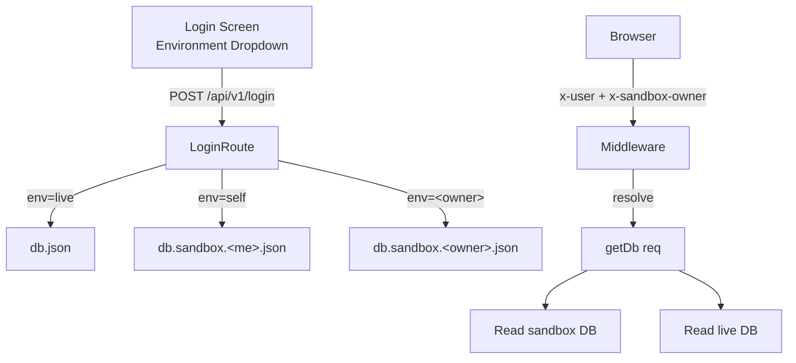

# DEVELOPMENT.md

NexusVSC / NexusERP — a per-customer ERP (Finance, Procurement, Inventory, Manufacturing, Shipment, CRM, Gov E-Invoice). One repo = one customer copy, distributed as an installed app (not SaaS).

This file is the **single source of project truth for developers and AI agents** — it consolidates and absorbs all developer specifications, agent guidelines, and operational procedures. If you change a project rule or feature architecture, update it here.

---

## Tech stack

| Layer | Tech |
|---|---|
| Frontend | React 19 + TypeScript + Vite 6 |
| Styling | Tailwind CSS 4 (via `@tailwindcss/postcss`) + PostCSS |
| Backend | Node.js + Express 5 (single `server.js`) |
| State | React hooks only — no Redux/Zustand |
| DB | Local JSON (`db.json` + `db.sandbox.*.json`) + optional Turso cloud sync (`@libsql/client`) |
| Archiving | Streaming `.nxarchive` v2 with `archiver` + `unzipper` + AES-256-GCM |
| Reporting & PDF | `jspdf` + `html2canvas` (with Arabic ligatures & bidirectional formatting) |
| i18n | Custom `LanguageContext` + `locales/translations.ts` (full Arabic + RTL support) |
| AI | Gemini (`@google/genai`) + OpenRouter/OpenAI with multi-model fallback engine |
| Auth | `x-user` header (always) + `x-sandbox-owner` header (in sandboxes) + `x-api-key` (machine/test clients) |


---

## Fastest path to a code change

1. **Find the feature module.** `components/{Feature}Module.tsx` — one file per business domain (see "Components by business domain" below).
2. **Read the type.** `types.ts` is the domain model. Add/modify interfaces here first.
3. **Read or add the API surface.** `services/dataService.ts` is the only HTTP client. Never call `fetch()` from a component.
4. **Read or add the server handler.** `server.js` registers routes near the top and a generic dispatch action endpoint `{ orderId, action, payload }` for mutations; generic CRUD lives at `/api/v1/<collection>`.
5. **Touch the DB carefully.** Roles and module mappings live in `db.json` `settings.availableRoles` / `settings.roleMappings`. Do not edit `db.json` by hand — use the schema migration system (see "Hard rules" §5).

---

## Setup commands

```bash
npm install            # install deps
npm run dev            # Vite dev server on :5005, proxies /api -> :3006
node server.js         # production-style: Express serves dist/ + API on :5005
npm run build          # Vite build -> dist/
```

> The backend listens **exclusively on port 5005** (or `process.env.PORT`). Ports 3005 / 4005 are intentionally free for external services. To restart, kill only the PID bound to 5005 — **never** `Stop-Process -Name node` or `taskkill /IM node.exe /F` (see "Build, Run, and Deploy Lifecycle" below).

**`VITE_BACKEND_URL`:** defaults to empty string → relative paths → same origin. Leave it unset in dev (Vite proxies `/api` to `:3006`) and in production (Express serves `dist/` on the same origin). Set it only when API and frontend are deployed to **different origins**.

There is no `npm test`. Functional tests are Node scripts in repo root (`test_*.js`, `verify_*.js`) and `scripts/*.cjs` (one-off maintenance). Run them with `node test_*.js`.

---

## Project layout (entry points only — for the rest, `ls <dir>`)

```
DEVELOPMENT.md           # this file (the single consolidated project truth)
AGENTS.md                # pointer to DEVELOPMENT.md for AI agent discovery
README.md                # AI-Studio stub; ignore for real work
App.tsx                  # root component, view router, sandbox banner, login/logout
index.tsx                # ReactDOM.createRoot mount
server.js                # Express: routes, dispatch, sandbox middleware, encryption, migrations
types.ts                 # domain model + enums (OrderStatus, UserRole, etc.)
constants.tsx            # APP_VERSION, status colors, role defaults, INITIAL_CONFIG
utils.ts                 # getItemEffectiveQty, getStatusLimitHours, calculateCatalogMatchScore
shared/margin.js         # isMarginBreach (used by both client and server)
convert_backup_format.js # migration utility for .nxarchive v2 streaming format
vite.config.ts           # port 5005, /api -> :3006 proxy, sandbox files in watch.ignored
tsconfig.json            # ES2022, react-jsx, path alias "@/*" -> ./*
render.yaml              # Render deploy (buildCommand + startCommand)

components/              # one file per business feature (see "Components by business domain")
services/dataService.ts  # the only HTTP client; getAuthHeaders() centralizes x-user + x-sandbox-owner
contexts/                # LanguageContext (i18n)
locales/translations.ts  # translation keys (full English + Arabic dictionaries)

.postman/  postman/      # Postman collection + workspace globals
uploads/                 # user uploads (pod, einvoices, wht_certificates, cost_sheets) — gitignored
dist/                    # vite build output — gitignored
db.json                  # live DB — gitignored, never commit
db.sandbox.*.json        # per-user / shared team sandboxes — gitignored
db.stub.json             # fresh-install template (commit-worthy; no prod data)
```

### Components by business domain

| Module | File | Approx. size |
|---|---|---|
| Finance (invoicing, payments, receipt PDF, P&L, stock orders, contracts) | `components/FinanceModule.tsx` | ~349 KB (largest) |
| Procurement (POs, outsourcing, tenders, supplier contracts) | `components/ProcurementModule.tsx` | ~344 KB |
| Inventory (stock, hub, metric filters, stock cards, reservations) | `components/InventoryModule.tsx` | ~191 KB |
| Settings / thresholds / ledger / backups / Turso sync / users | `components/DataMaintenance.tsx` | ~191 KB |
| Technical review, BoM, stock allocation, catalog sourcing | `components/TechnicalReviewModule.tsx` | ~142 KB |
| Order entry, line items, stock orders, blanket orders, contracts | `components/OrderManagement.tsx` | ~140 KB |
| Suppliers / deleted-suppliers vault / price lists | `components/SupplierModule.tsx` | ~75 KB |
| Dedicated part usage, order history & stock allocation tracking | `components/PartHistory.tsx` | ~54 KB |
| Profitability analysis & reporting | `components/ProfitabilityReport.tsx` | ~47 KB |
| Dispatch, POD, transit tracking | `components/ShipmentModule.tsx` | ~41 KB |
| Sourcing & delivery authorization (تسليمات / Taslemat) | `components/SourcingModule.tsx` | ~44 KB |
| CRM (customers, contacts, opportunities) | `components/CRMModule.tsx` | ~40 KB |
| Order details modal & tracking timeline | `components/OrderDetailsModal.tsx` | ~35 KB |
| Strategic AI assistant (Gemini + multi-model fallback) | `components/AIAssistant.tsx` | ~29 KB |
| Component studying & catalog match suggestions | `components/StudyingModule.tsx` | ~26 KB |
| Government e-invoice upload/tracking | `components/GovEInvoiceModule.tsx` | ~25 KB |
| Audit trails & system logs | `components/SystemLogs.tsx` | ~22 KB |
| Stock goods-in reception & warehouse check | `components/StockReceptionModule.tsx` | ~19 KB |
| Manufacturing floor execution & BOM tracking | `components/FactoryModule.tsx` | ~19 KB |
| Order executive reporting & management dashboard search | `components/OrderReport.tsx` | ~18 KB |
| Customer minimum profit margins management | `components/MinimumsModule.tsx` | ~10 KB |
| Help center + admin-managed links/videos | `components/HelpModule.tsx` | ~10 KB |
| Login + environment dropdown | `components/Login.tsx` | ~9 KB |
| Customer quick creation modal | `components/AddCustomerModal.tsx` | ~8 KB |
| Reusable sortable/draggable table | `components/SortableTable.tsx` | ~7 KB |
| Reusable stat card | `components/DashboardCard.tsx` | ~3 KB |
| Language switcher (EN/AR with RTL) | `components/LanguageToggle.tsx` | ~2 KB |
| Role-gated access wrapper | `components/ModuleGate.tsx` | <1 KB |

> **Module size matters:** Finance, Procurement, Inventory, DataMaintenance, and Technical Review are the five heavyweight modules. Don't try to read them top-to-bottom — use the entry points below.

---

## Feature entry points (read these first, then dive in)

When asked to change a feature, land on the row below, not on the file. All line numbers are in the current tree as of v1.0001099.

### Order Management

- **Module:** `components/OrderManagement.tsx` (top of file = "New Orders" tab + item form)
- **Order details modal:** `components/OrderDetailsModal.tsx:1` (the longest single screen the user sees)
- **Type:** `OrderStatus` enum + `CustomerOrder` interface in `types.ts`
- **Server dispatch:** `server.js:3446` `POST /api/v1/orders/:id/dispatch-action` — every status change, BoM commit, blanket-order link, stock allocation, item qty alter goes through here
- **Server switch (action cases):** `server.js:3580` `switch (action) { ... }` — add your new `case 'your_action':` here
- **Effective qty helper (used everywhere revenue/BoM is computed):** `utils.ts` `getItemEffectiveQty`
- **Contracts (Blanket Orders):** `server.js:3227` `COLLECTIONS` registry has `'contracts'`; `OrderManagement.tsx` 'Blanket Orders' tab; `FinanceModule.tsx` 'contracts' tab renders them via `SortableTable`
- **Blanket classification rule:** `isOrderBlanket` evaluates only the explicit `blanketOrder: true` flag — outsourcing items or component contracts no longer classify as Blanket Orders. Procurement's "Blanket Orders" tab was renamed to "Outsourcing" to avoid confusion (see i18n keys).
- **Blanket Order Trading Mode:** Blanket orders (`order.blanketOrder === true`) support the `TRADING` production type with multi-component sourcing. Unlike standard trade orders that enforce a 1:1 mirror component, blanket trade orders allow Technical Reviewers to add arbitrary components with any required quantities without clamping or overwriting.
- **Internal Stock Orders:** Dedicated classification when customer name is `"internal stock"` or customer reference / PO starts with `"STOCK-"` (`isStockOrder(order)` in `server.js`). Creation defaults: payment SLA = 0 days, applies withholding tax = false, project name = '', blanket contract ID = '', currency = 'L.E.', conversion rate = 1, price per unit = 0. Stock orders are exempt from customer wallet debt calculations, compliance logging violations, and margin blocks.
- **Sortable columns & Last Edited:** Table supports sorting by `lastEdited` (computed via `getLastEditedInfo(order)` inspecting human user logs while excluding `System`), `dataEntryTimestamp`, `customer`, etc.

### Technical Review

- **Module:** `components/TechnicalReviewModule.tsx`
- **SLA tracking & auto-transition:** Technical Review SLA starts from initial order logging or rollback (`technicalReviewStartedAt`, computed via `getTechReviewStartTime` in `utils.ts`). Item acceptance via `toggleAcceptItem` automatically moves orders in `LOGGED` status to `TECHNICAL_REVIEW`. When the order leaves technical review or is rejected, `technicalReviewFinishedAt` is recorded.
- **Header indicators:** Order header displays `ThresholdDisplay` for SLA countdown / overdue metrics.
- **Rollback to Logged & Dimmed Lock:** When a PO in Technical Review (blanket or non-blanket) is rolled back to `LOGGED`, it is assigned `rolledBackToLogged: true` and receives a fresh SLA clock (`dataEntryTimestamp` and `technicalReviewStartedAt` reset). The PO remains visible in the Technical Review queue but is styled as **dimmed** with a lock badge (`Rolled Back — Pending Logging Update`), and all editing actions (workflow switching, component addition, BoM modifications, position approval, finalization, and re-rollback) are locked with an explicit message that it cannot be edited until the Order Management / Logging team updates it. When the Order Management team updates the order in Order Management (`PUT /api/v1/orders/:id`), `rolledBackToLogged` is cleared, fresh SLA clocks are initialized, and full Technical Review edit capability is restored.
- **Stock Component Allocation (`allocate-stock-component`, `server.js:5212`):**
  - Technical Review operators can allocate components directly from available internal stock orders via `dataService.allocateStockComponent(...)`.
  - When allocating:
    - The source stock order tracks `allocatedQty`, reduces remaining `quantity`, sets `status = 'DEPLETED'` when exhausted (`remaining <= 0.0001`), generates audit logs on the source stock order, and reconciles inventory (`reconcileInventory`).
    - The target order item receives a component linked to the source stock order (`allocatedFromStockOrderId`, `allocatedFromStockOrderRef`, `allocatedFromStockCompId`, `allocatedFromStockItemId`).
    - If the requested quantity exceeds available stock, a remainder component is automatically created in `PENDING_OFFER` for standard procurement.
  - Background reconciliation: `reconcileStockAllocations(db, targetPath)` (`server.js:1411`) runs on startup and mutations, auditing all active customer orders to ensure stock order remaining quantities accurately reflect live non-rejected allocations.
- **Trading Line Item Auto-Mirror:** If a line item is TRADING and missing its initial mirror component, it is automatically restored (`repairTradingMirrorOrders` in `server.js`).
- **Binary Cost Sheet Upload (`POST /api/upload-cost-sheet`):** Physical file upload via `dataService.uploadCostSheet` (`multipart/form-data`), saving to `uploads/cost_sheets/` (or `uploads/sandbox/<owner>/cost_sheets/`) instead of embedding bloated base64 strings in `db.json`.

### Procurement

- **Module:** `components/ProcurementModule.tsx` (~344 KB — uses `SortableTable` everywhere; purchases, tenders, and outsourcing in one file)
- **Server:** `server.js:3119` `GET /api/v1/procurement/history` (cross-order procurement history)
- **Type:** `ProcurementLine` in `types.ts`
- **PO reference / project badges:** procurement headers always render the customer's PO ref + project/non-project indicator
- **Cost sheet data population & per-project extraction:** For outsourcing orders, cost sheet metrics (working resource count and total real cost) are extracted per project from the uploaded cost sheet by matching the order's project name to its `"اجمالى <project>"` block (person count + right-most column sum). If an order specifies a project not present in the sheet, it displays 0/0 and warns the user with available sheet projects. Falls back to whole-sheet extraction if no project block is matched.
- **Interactive Cost Sheet Cascading Formulas & Excel Baking:**
  - In the interactive cost sheet editor, formulas are recomputed live via `computeResolvedCostSheetValues(cells, rowOffset, colOffset)` using a multi-pass (up to 6 passes) fixed-point engine. Formulas referencing other calculated cells dynamically update as editable green cells are typed into.
  - On save, resolved formula values are written into each formula cell's cached value (`worksheetCell.v = val`), allowing downstream parsers using `XLSX.utils.sheet_to_json` to immediately reflect updated Working Resource counts, Real Costs, and invoice totals.
- **Cost sheet history, latest active sheet & deletion rollback:**
  - `targetItem.costSheets[]` maintains full upload history. History chips displayed on Outsourcing order cards are filtered strictly to cost sheets uploaded/modified in the **current calendar month**, while the latest active sheet drives the card's main metrics (working resources and real cost).
  - The latest uploaded sheet in the current month is highlighted (`★ Latest`, green border and ring).
  - "View Sheet" and "Real Cost to Company" always show and evaluate against the latest active uploaded sheet.
  - Older historical sheets are download-only and cannot be opened in the interactive editor.
  - A small Delete button appears under the latest sheet chip. Clicking it triggers `delete-cost-sheet-record` (`server.js:4214`), which removes the record, promotes the previous record as active, restores previous `costSheetFile` and metrics (`workingResourceCount`, `realCost`, `invoiceTotal`), and syncs component costs. When only 1 sheet remains, the Delete button is disabled/dimmed to preserve the active cost sheet.
- **Blanket Order Project Consolidation & Project Orders History:**
  - In the Procurement Outsourcing tab (`components/ProcurementModule.tsx`), blanket orders (`isOrderBlanketType(order)`) sharing the same project name (`getOrderProjName(order)`) are consolidated into a single card ("as if they were one large order").
  - The card header prominently displays quick info for the "latest" order in that project: Customer PO Number, Internal Order Number, and PO Received Date.
  - A toggleable "Project Orders History" dropdown link in the header opens an embedded subcard showing all orders in the project row by row: Customer PO Number, Internal Order Number, Received Date, and download pills for all cost sheets uploaded during that order's PO calendar month.
- **PO Cancellation vs PO Extension & Amendment Architecture (Two-Case Lifecycle):**
  - **Case 1: Standard Direct Cancellation** (`cancel-po` / `cancel-po-batch`):
    - Applies when components on the PO have **zero goods received** (`receivedQty === 0`) and **zero supplier payments** recorded (`compPaidAmount <= 0.01`).
    - The PO is cancelled directly, and the full component quantity returns to `PENDING_OFFER` for immediate re-procurement from alternative suppliers.
  - **Case 2: PO Extension & Amendment (Superseding Original PO)** (`amend-po-extension`):
    - When any component has already been received into stock (`receivedQty > 0`) or paid for by Finance (`paidAmount > 0.01`), **direct PO cancellation is strictly blocked**.
    - The user must approve the PO Extension & Amendment workflow:
      - The system calculates the new amended PO quantity: `newPoQty = min(originalQty, max(receivedQty, round(paidUnits * 1000) / 1000))`.
      - The existing component PO quantity is amended down to `newPoQty`, flagged with `isExtension: true`, `supersededOriginalPo: true`, and stores `originalPoQuantity`, `supersededPoNumber`, `extensionReason`, and `extendedAt`.
      - **Subcase 2-1 (Paid Equals Received Goods Value):** Payment matches received items value. PO is amended to received quantity and superseded. The supplier order in Finance is 100% fulfilled and settled.
      - **Subcase 2-2 (Advance Payment Exceeds Received Goods):** Finance paid for more items than currently received. The PO is adjusted to the paid quantity and superseded. Unreceived paid items are tracked in Inventory (awaiting receipt) and Finance (`paidUnreceivedQty`).
      - **Subcase 2-3 (Delivered Goods Exceed Payments):** Delivered goods exceed paid amounts. The PO is adjusted to the received quantity to protect warehouse inventory, and Finance continues tracking the remaining Accounts Payable (AP) balance due.
      - **Leftover Re-Procurement:** If there is unfulfilled leftover quantity (`leftoverQty = originalQty - newPoQty > 0`), a new component is automatically created for the customer order in `PENDING_OFFER` with `splitFromExtensionPo: oldPoNumber` and `splitReason: cancelReason`, allowing Procurement to immediately procure the remainder.
      - **Automatic Order Status Rollback:** If the customer order was in `WAITING_FACTORY`, `MANUFACTURING`, or `READY_FOR_PRODUCTION`, unfulfilled leftover components automatically revert the order back to `WAITING_SUPPLIERS`.
  - **PO Reversion to Award** (`revert-po-to-award`): Returns the order lines to the awarded supplier state for renegotiation, releasing any received items to free stock via `transferReceivedItemsToFreeStock`.
- **Action Modals UX (Send RFP & Award Tender):**
  - Action popups (`activeAction`) use a viewport-constrained layout (`max-h-[88vh]` with pinned header, pinned footer, and scrollable middle container) so that submission/abort buttons are always visible without scrolling the browser window.
  - In Send RFP, suppliers are selected via a compact multi-select list box with search filtering and Select All / Clear controls, replacing bulky card grids.
  - In Award Tender, suppliers are selected via a matching compact single-select list box with search.
  - i18n support in `ProcurementModule.tsx` leverages `const { t, language } = useLanguage(); const isAr = language === 'ar';`.

### Inventory

- **Module:** `components/InventoryModule.tsx` (~191 KB)
- **Stock-reception sub-view:** `components/StockReceptionModule.tsx` (PO goods-in; creates inventory)
- **Stock Goods-In for Amended / Extended POs:** When receiving items for amended POs (`comp.isExtension`), the table prominently displays an "Amended PO Qty" badge with the original PO quantity tooltip. Expected quantity is accurately computed as `Math.max(0, quantity - receivedQty)`, displaying previously received counts to prevent duplicate reception.
- **Full Arabic Localization & Bidirectional RTL:** Fully localized using `useLanguage()`, RTL direction support (`dir={isAr ? 'rtl' : 'ltr'}`), and persistent language state across reloads.
- **Clickable Metric Filter Cards (`StockMetricFilter`):**
  - Metric cards for Total Stock, PO-Linked, Reserved, and Free Warehouse Stock with active ring highlights.
  - Clicking a metric card dynamically filters the item list across both Component Stock and Product Hub subtabs.
- **Item Stock Card Modal (`ItemStockCardModal`):** Comprehensive drill-down modal showing an item's complete transaction history, stock movements, batch numbers, bin locations, reservations, allocations, and valuation metrics.
- **Unique SKU rule:** enforced in `InventoryModule.tsx` (case-insensitive, whitespace-trimmed)
- **Warehouse Stock Receipt for Stock Orders:** Components received from internal stock orders are recorded into general warehouse stock (action `RECEIVE`, logging to `invItem.logs`), auto-fulfilling when all components are delivered. External customer trading products route to Product Hub (`item.hubReceivedQty`).
- **Automatic Stock Release (`transferReceivedItemsToFreeStock`, `server.js:3509`):** When orders are rolled back to logged, rejected, or POs cancelled/reverted, all received components and Product Hub trading items are safely transferred to General Component Stock in `db.inventory` with `RELEASED_TO_STOCK` logs.
- **Server:** generic `GET/POST/PUT/DELETE /api/v1/inventory` (registered in `COLLECTIONS` at `server.js:3227`)

### Suppliers & Part History

- **Suppliers Module:** `components/SupplierModule.tsx` (~75 KB)
- **Part History Module:** `components/PartHistory.tsx` (~54 KB — dedicated historical analysis of components, part usage, supplier POs, contracts, cancellation/revert reasons, and stock order allocations)
- **Deleted-Suppliers vault** (admin-only, strictly immutable): handled inside `SupplierModule.tsx`
- **Admin-only inline edit:** `isAdmin = userRoles.includes('admin')` gate — preserve when extending
- **Type:** `Supplier` + `SupplierPart` in `types.ts`
- **Server:** generic `GET/POST/PUT/DELETE /api/v1/suppliers`; autofill rank `calculateCatalogMatchScore` in `utils.ts`

### Manufacturing (Factory)

- **Module:** `components/FactoryModule.tsx`
- **Production start / finish flows:** see `test_production_start.js`, `test_production_finish.js` in repo root for the exact HTTP shape
- **Test scripts:** `test_mfg_consumption.js`, `test_mfg_consumption_v2.js`, `test_mfg_start_consumption.js` are the canary scripts for this area

### Shipment / Dispatch

- **Module:** `components/ShipmentModule.tsx`
- **POD uploads:** land in `uploads/{pod,einvoices,wht_certificates}/` (or `uploads/sandbox/<owner>/...`); file-serving is local-only, no CDN
- **Server:** `/api/v1/integrations/storage/upload` at `server.js:6390`; Google Drive upload at `server.js:6326`

### CRM

- **Module:** `components/CRMModule.tsx`
- **Add-customer modal:** `components/AddCustomerModal.tsx`
- **Customer merge:** `server.js:3167` `POST /api/v1/customers/merge`
- **Type:** `Customer` in `types.ts`

### Sourcing & Delivery Authorization (تسليمات / Taslemat)

- **Module:** `components/SourcingModule.tsx`
- **Role:** `sourcing` (mapped in `constants.tsx` and initialized via schema v9 migration in `server.js`).
- **Dashboard & Authorization:** Sourcing operators inspect orders and line items that have arrived in the Product Hub.
- **Dual Financial Intelligence:** Each order card displays (1) Order Financial Status (Gross Revenue, Amount Paid, Remaining Balance, Downpayment Coverage %) and (2) Overall Customer Financial Status (Invoiced, Collected, Balance, Prepayment Wallet).
- **Delivery Clearance:** Operators can authorize deliveries up to downpayment coverage ("Max Paid") or exercise manual discretion ("All in Hub") to bypass the suggested quantity, with explicit reason logging via `approve-dispatch-receipt`.

### Finance

- **Module:** `components/FinanceModule.tsx` (~349 KB — largest module in the codebase)
- **General Ledger Combobox (`GeneralLedgerView`):** "To Account" selection combines standard ledger accounts, system customers, and individual customer purchase orders (sorted descending from newest to oldest by date/timestamp).
- **Multi-Field Real-Time Search:** Search filters across account names, customer names, PO reference numbers, internal order numbers, and project names.
- **Automatic PO Payment Synchronization (`server.js`):** When an addition entry is saved with a target PO (`orderId` / `poNumber`), the server automatically appends a payment to `order.payments` and records an entry in `order.history`. `companyFinancials` and unified entry views exclude duplicate ledger payments to ensure double-entry precision.
- **Collapsible order cards** (default closed) + Expand All/Collapse All toolbar control — preserve this UX
- **Universal multi-query search** supports `project` / `non-project` keywords — preserve
- **Finance Stock Orders Tab (`stock_orders`):** Dedicated tab isolating internal stock orders from commercial customer receivables, billings, and wallets. Highlights Grand Total Stock Value, active lines, allocated vs remaining stock quantities, and per-line valuation breakdown.
- **Payment Receipt PDF Generation (`generateReceiptPDF`, `FinanceModule.tsx:641`):**
  - Generates high-fidelity PDF payment receipts on demand for any historical or newly recorded customer payment using `safeHtml2Canvas` + `jsPDF`.
  - Enforces `fontVariantLigatures: 'normal'` and bidirectional Arabic regex detection (`/[\u0600-\u06FF]/`) to ensure proper Arabic glyph shaping and correct RTL text alignment.
  - Exports cleanly formatted A4 PDF (`Receipt-${safeOrderNum}-${safeReceiptNum}.pdf`) with multi-page support, company rasterized logo, customer information, tax clearances, order balance, and previous payments history.
  - Direct "Generate Receipt" download button in the order payments history table and payment recording modal.
- **Decision Modals Stock Release Warnings:** Modals for Void Invoice, Reject Order, and Revert to Sourcing render clear advisories warning that received goods are released to free warehouse stock.
- **Blanket History Tab (`blanket_history`):** Dedicated monthly archive view grouping blanket orders by creation month (descending order) with search filtering and direct one-click download buttons for each order's latest uploaded cost sheet (`downloadCostSheetFile`).
- **Blanket vs. Non-Blanket Indicators:**
  - `showBlanketBadge` displays a teal **Blanket** badge only when the order is associated with a blanket contract (`blanketOrder || contractId || blanketContractId`) **and** Procurement has certified that "No RFP Needed" (`isOrderNoRfpNeeded(o)`).
  - Otherwise, displays a **Non-Blanket** badge with tooltip explaining whether it is a standard order or awaiting Procurement's No RFP Needed clearance.
- **Supplier AP PO Extension & Paid-Unreceived Tracking:** The Supplier AP tab tracks amended/extended supplier POs with a purple "Amended PO" badge (`po.isExtension`). If Finance recorded payments that exceed currently received warehouse quantities (`paidUnits > receivedQty`), the system computes and renders an indigo `paidUnreceivedQty` badge (e.g. `X units paid but unreceived`) and tracks total company `paidUnreceivedValue`. This provides immediate visibility into supplier prepayments awaiting fulfillment without distorting inventory or invoice liability.
- **Settle blanket order / financial request** action lives in the contracts table within this module
- **Type:** `LedgerEntry` in `types.ts`
- **Server:** generic `GET/POST/PUT/DELETE /api/v1/ledger`; supplier payments at `server.js:6497-6590`
- **PDF export:** dashboard's executive snapshot (status distribution, critical margin alerts, customer/supplier summaries) is restricted to the `management` role; uses `jspdf`, lives in `App.tsx`.

### Government e-Invoice

- **Module:** `components/GovEInvoiceModule.tsx`
- **WHT certificates** also stored in `uploads/wht_certificates/`

### AI Assistant (strategic + OCR)

- **Module:** `components/AIAssistant.tsx`
- **Server proxy (OpenAI-compatible):** `server.js:6914` `POST /api/v1/ai-proxy/chat` — single point where browser calls go through
- **Multi-model fallback queue:** the OCR engine in `OrderManagement.tsx` and this module share the same queue; do not bypass with raw SDK calls
- **Sandbox context:** the assistant ingests `isSandbox` / `sandboxOwner` / `environmentName` automatically

### Settings / Data Maintenance

- **Module:** `components/DataMaintenance.tsx` (largest settings surface — thresholds, ledger accounts, encryption, backups, Turso cloud sync, help content, integrations, user management, sandbox admin)
- **Turso Database Cloud Sync:** UI toggle and configuration (`useTurso`, `tursoUrl`, `tursoAuthToken`) for write-through background sync to Turso cloud.
- **Integrations:** Google Drive OAuth routes at `server.js:6115-6390`; local storage at `server.js:6139-6189`
- **Backups:** full backup `server.js:5424` (streaming `.nxarchive` v2); users+groups `server.js:5694`; restore `server.js:5490`; full-restore `server.js:5563` (disk-based streaming extraction)
- **Settings persistence (encryption):** see "Sensitive data encryption" below

### Help Center

- **Module:** `components/HelpModule.tsx` (user-facing; displays `settings.helpLinks` + `settings.helpVideos` as clickable cards and YouTube embeds)
- **Admin editor:** inside `components/DataMaintenance.tsx` (admin-only) — add/edit/delete links and video URLs
- **Backed by:** `settings.helpLinks` + `settings.helpVideos`. Initialized empty by schema migration v2.

### Login & Auth

- **Module:** `components/Login.tsx` (300 ms debounced `/api/v1/auth/environments` lookup)
- **Server login:** `server.js:6045` `POST /api/v1/login` (4 branches: factory backdoor, live, self, shared)
- **Sandbox discovery cache:** `server.js:44` `discoveryCache = new Map()` (30 s TTL, 60 s sweeper)
- **Auth environments endpoint:** `server.js:5848`
- **App shell (login/logout/sandbox banner/router):** `App.tsx:1-120` (entry) — rest of file is the view router; the persistent sandbox banner lives around `App.tsx:807-835`

### Sandbox (v3.5.1) — entry-point summary

- **Multi-tenant middleware:** `server.js:2461` (sets `req.sandboxDbPath`, `req.sandboxOwner`, `req.roles` — once, before any route)
- **Admin check hard rule (`isAdminUser(req)`):** `server.js:730`. Live mode has `req.roles = []` by design (zero disk I/O); sandbox mode populates `req.roles` from the live-synced user. Handlers checking admin authorization MUST call `isAdminUser(req)`. Calling `req.roles.includes('admin')` directly will silently fail in live mode.
- **API key authentication (`x-api-key` or `Authorization: Bearer <key>`):** `server.js:2462` allows ERP Test Tool, machine clients, and third-party integrations to authenticate via API key. Inherits all live user roles. Calls are **strictly routed to the owner's personal sandbox by default**, unless explicitly created/toggled with `allowLive: true`.
- **API User Guide (`GET /api/v1/user-guide`):** `server.js` and `api_user_guide.js` provide complete, machine-readable (JSON) and downloadable Markdown REST documentation. Client helper: `dataService.get_user_guide()`.
- **`getDbPath` / `isSandbox` / `getDb` helpers:** `server.js:41-42`
- **Sync authoritative users:** `server.js:72`; sweeps all sandboxes on boot and on every user mutation
- **Migrations at startup:** `server.js:6959` `migrateAllSandboxesOnStartup()` (before `app.listen()`)
- **`app.listen`:** `server.js:7011` — wrap this in `if (require.main === module)` for Vercel compatibility (see "Deploying to Vercel" below)
- **`/api/v1/wipe` (live only):** `server.js:3238`
- **`/api/v1/sandbox/reset` (sandbox only):** `server.js:3246`
- **`/api/v1/sandbox/revert-login`:** `server.js:3262`
- **Admin sandbox list:** `server.js:5916`; client polling (`App.tsx`) is guarded by `currentUser.roles.includes('admin')` to avoid 403 Forbidden errors when non-admin users work in sandbox mode.
- **Admin switch-sandbox:** `server.js:5983`
- **Schema migration chain:** `server.js` `const migrations = [...]`; `CURRENT_SCHEMA_VERSION = 11` at `server.js:119`
- **Spec doc:** `C:\Users\moata\.local\share\kilo\plans\1786643099095-user-sandbox-plan.md` (Amendment v3.5.1 at the top)

### Shared utilities (used by both client and server)

- **Margin breach check:** `shared/margin.js` `isMarginBreach(cost, markupPct, minMargin)` — used by Order Management and server `dispatchAction`
- **Effective qty:** `utils.ts` `getItemEffectiveQty`
- **Status-time limits:** `utils.ts` `getStatusLimitHours(status, settings)`
- **Catalog match score:** `utils.ts` `calculateCatalogMatchScore` (Technical Review + Studying autocomplete)
- **`safeHtml2Canvas` (Tailwind CSS 4 & Arabic Ligatures Safe Wrapper):** `utils.ts` `safeHtml2Canvas(element, options)`. Sanitizes modern CSS color spaces (`oklch()`, `oklab()`, `lch()`, `lab()`, `color()`) by evaluating them onto an offscreen canvas to produce standard `rgba(...)` before `html2canvas` parses them (preventing render crashes under Tailwind CSS 4). Neutralizes `letter-spacing` on Arabic text (`/[\u0600-\u06FF]/`) to `0px` to prevent cursive Arabic ligatures from breaking apart during canvas rasterization. Used across `FinanceModule.tsx`, `ProcurementModule.tsx`, `ShipmentModule.tsx`, and `OrderDetailsModal.tsx`.

---

## Coding patterns (must follow)

1. **Module-per-feature.** One large file per business domain. Extract to `SortableTable` / `ModuleGate` / `DashboardCard` only when reused >1x.
2. **Data service abstraction.** All server calls go through `services/dataService.ts`. `getAuthHeaders()` adds `x-user` (always) and `x-sandbox-owner` (in sandboxes). The header drives tenancy; the URL does not. Mutations use generic dispatch `{ orderId, action, payload }`. **Server-side collection safety:** `addToCollection` in `server.js` initializes `db[col] = []` before pushing, so missing collections are created on the fly. `updateInCollection` treats `settings` and `modules` as upserts (encrypts `settings` via `encryptSettings` on creation).
3. **Quantity alteration.** When an item's qty is lowered post-creation, use `alteredQty` + `alterationComment`. Always compute revenue/fulfillment/BoM via `getItemEffectiveQty(item)`. Original `quantity` is never mutated. PO line items with `0`/blank qty are read-only `1`s via the same helper. `processedOrderInternal` does **not** write `quantity` back.
4. **Margin protection.** `NEGATIVE_MARGIN` is sticky. `isMarginBreach(cost, markupPct, minMargin)` lives in `shared/margin.js` (shared client/server). The `NEGATIVE_MARGIN` block fires only when component costs are actually identified (`totalCost > 0`) **and** markup is below the configured minimum. Newly logged POs with no costs stay in `LOGGED`. The status only exits when costs appear, the markup recovers, or components are removed — preventing silent auto-regression while costs are still unknown.
   - **Procurement-safe NEGATIVE_MARGIN recovery (critical rule):** When recovering from `NEGATIVE_MARGIN`, `evaluateMarginStatus` MUST check if any component is still in an active procurement state (`PENDING_OFFER`, `RFP_SENT`, `AWARDED`, `ORDERED`, `WAITING_CONTRACT_START`). If yes, the order must recover to `WAITING_SUPPLIERS` — **not** `TECHNICAL_REVIEW`. Returning to `TECHNICAL_REVIEW` silently hides the order from the Procurement module (which filters out `TECHNICAL_REVIEW` orders at `purchaseGroups` line 1304). The primary fix is in `evaluateMarginStatus` Priority 3 (`server.js:~383`); a secondary belt-and-suspenders guard is in `processOrderInternal` after the `evaluateMarginStatus` call (`server.js:~1737`). This applies to Non-Blanket TRADING and MANUFACTURING POs only (blanket orders are exempt from margin checks entirely at Priority 0).
5. **Modal action pattern.** User actions open a local modal with draft state → validate → call `dataService` → parent refresh via callback → modal cleans up.
6. **Status-driven workflow.** `OrderStatus` enum in `types.ts`. Server `dispatchAction` enforces valid transitions. Frontend renders by `order.status`, never derived flags.
7. **Role-based gating.** Every top-level module route checks `ModuleGate` against the user's role. The actual list of available roles and module mappings live in `db.json` (`settings.availableRoles`, `settings.roleMappings`); the frontend pulls them at runtime via API.
8. **Blanket Order Project Grouping & Cost Sheet Extraction (Procurement & Finance).**
   - Blanket orders sharing the same `projectName` are consolidated into a single unified project group card in both Procurement (`components/ProcurementModule.tsx`) and Finance Operations (`components/FinanceModule.tsx`).
   - In Finance (`'orders'` tab), blanket orders group at the position of the first sorted order among them, preserving table sorting order while consolidating project items.
   - The blanket card provides quick info for the latest order (`Customer PO #`, `Internal #`, `PO Date`), an expandable `Project Orders History (N)` dropdown subcard showing past orders with their respective calendar-month cost sheet download links, and cost sheet history chips filtered strictly to the current calendar month.
   - Outsourcing metrics dynamically extract Working Resources, Real Cost (`اجمالى <project>` / right-most cost column), and Total Invoice (`اجمالي الفاتورة` / `اجمالى الفاتورة` column) directly from the uploaded Excel cost sheets. Finance includes an interactive spreadsheet viewer modal for inspecting parsed sheets.
   - **Wallet Badges & Project Wallets View:**
     - The Finance Blanket Project card displays both a **Project Wallet** badge (project-specific balance for the customer) and a **Customer Wallet** badge (aggregate customer credit/debt balance).
     - Standard non-blanket orders in Finance (`renderOrderRowContent`) display a **Customer Wallet** badge in the context column.
     - Finance Operations provides a dedicated **Project Wallets** tab (`project_wallets`) mirroring Customer Wallets, aggregating per-project credit and debt across all customers with deep search, summary totals, and nested customer allocation tables (`GET /api/v1/project-wallets`).
   - **Strict Exclusion of Rejected Orders & Cost Sheets (`OrderStatus.REJECTED`):**
     - Rejected blanket orders and standard orders MUST NOT appear in any operational view (Procurement, Finance, Orders, Technical Review, Inventory, Shipment, Contracts, History, or Part History).
     - The **Management Dashboard Search** (`OrderReport.tsx` under `activeView === 'dashboard'`) is the **ONLY** view authorized to display and search rejected orders.
     - Rejected blanket orders are never counted in project groups, and all their linked cost sheets and history are strictly excluded from history chips and Project Orders History dropdowns. If all blanket orders for a project are rejected, the project card does not appear at all.
     - **Wallet Isolation:** Rejected orders never generate commitments, debts, or settlement adjustments. Projects that only have rejected orders are completely purged from `customer.walletBalances` and `GET /api/v1/project-wallets`.
9. **Internal Stock Orders & Stock Component Allocation.**
   - Internal stock orders (`customerName === 'internal stock'` or customer PO starting with `STOCK-`) represent internal warehouse inventory replenishment. They are strictly segregated from commercial customer revenues, billing SLAs, withholding tax, and customer/project wallets.
   - They are exempt from margin checks and `NEGATIVE_MARGIN` status auto-transitions.
   - When components are allocated to a customer order (`dataService.allocateStockComponent` / `allocate-stock-component`), the stock order tracks `allocatedQty`, decrements remaining quantity, marks `DEPLETED` on exhaustion (`<= 0.0001`), and reconciles via `reconcileInventory` and `reconcileStockAllocations`.
   - Remainder components (when requested quantity exceeds available stock) automatically generate standard procurement components in `PENDING_OFFER`.
10. **Automatic Stock Release on Order Lifecycle Events (`transferReceivedItemsToFreeStock`).**
    - Whenever an order is rolled back to `LOGGED`, rejected (`reject-order`), or has a supplier PO cancelled (`cancel-po` / `cancel-po-batch`) or reverted to award (`revert-po-to-award`), all received items (both components and Product Hub trading items) MUST be automatically transferred to General Component Stock in `db.inventory` with `RELEASED_TO_STOCK` audit logs.
    - Prevents orphaned reservations and phantom inventory locks. Resets `receivedQty = 0`, clears `inventoryItemId`. If the order was in factory/production (`WAITING_FACTORY`, `MANUFACTURING`, `READY_FOR_PRODUCTION`), automatically reverts order status to `WAITING_SUPPLIERS`.
11. **Binary File Uploads for Spreadsheets & Cost Sheets (Memory Safety).**
    - Never read large spreadsheets or document attachments as base64 data URLs in React components.
    - Upload binary `File` objects directly via `dataService.uploadCostSheet` (`POST /api/upload-cost-sheet` with `multipart/form-data`) saving to `uploads/cost_sheets/`. Store only the file relative path in `db.json`.
12. **Multi-Language (i18n), RTL Layouts, and Ligature-Safe PDF Generation.**
    - All user-facing strings must use `useLanguage()` and `t(...)` from `locales/translations.ts`.
    - Support bidirectional RTL layout dynamically (`dir={isAr ? 'rtl' : 'ltr'}`).
    - For PDF receipt generation involving Arabic text (`generateReceiptPDF`), enforce `fontVariantLigatures: 'normal'` and bidirectional regex detection (`/[\u0600-\u06FF]/`) to preserve proper Arabic glyph shaping and layout alignment.
13. **Server Tenancy & Admin Authentication (`isAdminUser(req)`).**
    - In Sandbox mode (`x-sandbox-owner` present), `req.roles` is populated from the live-synced user.
    - In Live mode (no header), `req.roles` is `[]` BY DESIGN for zero disk I/O.
    - Any admin check on the backend MUST use `isAdminUser(req)` instead of `(req.roles || []).includes('admin')`. Calling `req.roles.includes('admin')` in live mode will silently deny every live caller.

---

## Adding a new feature (canonical 7-step)

1. **Component:** `components/{Feature}Module.tsx` (or a `{Action}Modal.tsx` for actions).
2. **Types:** add interfaces to `types.ts`. Co-locate runtime helpers there if needed.
3. **Service:** add API methods to `services/dataService.ts`.
4. **Server:** add dispatch action cases / CRUD handlers to `server.js`. Register new collections in the `COLLECTIONS` registry.
5. **Constants:** register role mapping in `constants.tsx`.
6. **Database:** if the feature introduces new roles / settings, **add a migration** in `server.js` and bump `CURRENT_SCHEMA_VERSION` (see Hard rule §5). Do not hand-edit `db.json`. **`db.json` is the runtime authority** — if you skip this step the feature will not appear on a machine even though the code is correct.
7. **Router:** wire the component + `ModuleGate` into `App.tsx`.

---

## Conventions

- **Branch from `master`.** Conventional commit messages (`feat:` / `fix:` / `docs:` / `refactor:`).
- **Branch topology (AI work):** `origin/AI_Nexus` is the AI-development stream and is a *linear descendant* of `NexusVSC` - it branches off the current `NexusVSC` tip, so the two never diverge. Integrate it with `git merge --ff-only origin/AI_Nexus`: no conflicts, and the incoming commit keeps its original hash. **Do not cherry-pick a single `AI_Nexus` commit.** `server.js` drifts ~1,500 lines across the stream, so the patch context does not apply (verified: `git apply --3way` fails on both `constants.tsx` and `server.js`), and features like `lineStatus` / `costBasisQty` were introduced by *earlier* commits in the stream - a lone cherry-pick lands half-wired code.
- **TypeScript strict-ish** (`tsconfig.json` has `noEmit: true` + `allowImportingTsExtensions`). Run `npx tsc --noEmit` to typecheck (no script wired; use that command).
- **Path alias:** `@/foo` -> `./foo` (configured in both `vite.config.ts` and `tsconfig.json`).
- **i18n:** add keys to `locales/translations.ts`, never hardcode user-facing strings in a component if the codebase has them in the catalog.
- **Postman:** new API endpoints go in `.postman/` (collection) and `postman/` (workspace globals).
- **Tailwind 4:** config in `tailwind.config.js`, plugin in `postcss.config.js`. No `tailwind.config.js` directives — uses `@tailwindcss/postcss`.

---

## Build, Run, and Deploy Lifecycle

Two-step lifecycle — Step 1 and Step 2 are intentionally separate. Do not commit and push without explicit user instruction.

### Step 1: Rebuild and restart (local / staging)

Trigger phrase: "rebuild" / "rebuild and restart". Runs only this sequence — does not commit or push.

1. **Advance the version:** open `constants.tsx`, find `export const APP_VERSION = 'X.XXXXXX';`, increment by `0.000001`, save. (See "Application versioning" below for the rule.)
2. **Install deps:** `npm ci`
3. **Build:** `npm run build` → `dist/`
4. **Restart the app on port 5005:** find the PID bound to 5005, kill only that one, start `node server.js`.

> ⚠️ **Windows restart rule — never wildcard-kill node.** Other apps on ports 3005 / 3006 / 4005 may also be using node. Always:

```powershell
# Mavis / MiniMax Code agent — use WMI Terminate, NOT Stop-Process.
# See "Restarting the app — Mavis / MiniMax Code agent note" below for why.
Get-NetTCPConnection -LocalPort 5005              # find the PID
$proc = Get-CimInstance Win32_Process -Filter "ProcessId=<pid>"
Invoke-CimMethod -InputObject $proc -MethodName Terminate   # kill via WMI
# then start a new instance in a non-elevated shell:
#   cd "C:\Users\moata\Documents\antigravity\sharp-rutherford"; node server.js
```

Local URL: `http://localhost:5005`.

### Step 2: Commit and push (separate, on explicit request only)

Trigger phrase: "commit and push" / "push it". Never auto-triggered.

```bash
git add .
git commit -m "..."
git push origin <branch>
```

---

## Restarting the app — Mavis / MiniMax Code agent note

> **Applies to Mavis / MiniMax Code only.** This section is for any Mavis (MiniMax Code) session that needs to restart the running `node server.js` on port 5005. If you arrived here from **Antigravity**, this section is **not** for you — Antigravity's process-management path does not have the restriction described below and can use `Stop-Process -Id <pid> -Force` directly. Read it only so you understand the Mavis-side workaround, then proceed with whichever kill path your environment actually requires.

### The problem

When this `node server.js` was started by **Mavis / MiniMax Code** (or by VS Code's `language_server.exe`, or by any elevated parent process), the resulting `node.exe` inherits a restricted DACL on its process handle. From a normal Mavis-spawned PowerShell — even one where `whoami` shows the same user — the following all fail with **"Access is denied"**:

- `Stop-Process -Id <pid> -Force`
- `taskkill /F /PID <pid>`
- `Get-Process -Id <pid> | Stop-Process -Force`
- `Get-Process -Id <pid> | ForEach-Object { $_.Kill() }` (uses `TerminateProcess` under the hood — same DACL check)
- A scheduled task registered as `SYSTEM` with `RunLevel=Highest` running `taskkill /F`
- `Start-Process powershell -Verb RunAs` (triggers UAC; the agent cannot auto-click the consent prompt)
- `wmic process where ProcessId=<pid> call terminate` (`wmic` is not on PATH on Windows 11)

This is **not** a missing-elevation problem. The shell appears non-elevated because the IDE/agent's parent process tree is running with a restricted token, and the agent shell inherits that restriction.

### The path that works

**WMI `Win32_Process.Terminate()` via `Invoke-CimMethod`** — goes through the WMI service (which runs as SYSTEM in a different session) and bypasses the per-process DACL check.

```powershell
# 1. Find the PID on port 5005
$pid5005 = (Get-NetTCPConnection -LocalPort 5005 -ErrorAction SilentlyContinue |
            Where-Object OwningProcess -ne 0).OwningProcess | Select-Object -First 1

# 2. Kill it via WMI (returns ReturnValue=0 on success)
$proc = Get-CimInstance -ClassName Win32_Process -Filter "ProcessId=$pid5005"
Invoke-CimMethod -InputObject $proc -MethodName Terminate

# 3. Start a new node server.js in a non-elevated shell
#    (do this from a regular PowerShell, NOT from this agent shell)
Set-Location "C:\Users\moata\Documents\antigravity\sharp-rutherford"
Start-Process node -ArgumentList "server.js" -WorkingDirectory (Get-Location) -WindowStyle Hidden
```

### Verify the kill actually took effect

After the WMI `Terminate` returns 0, the kernel recycles the PID almost immediately. If you query `Get-NetTCPConnection -LocalPort 5005` right away and see a PID, that may be a **recycled PID holding the same number**, not your old process. Verify with:

```powershell
$test = Get-Process -Id $pid5005 -ErrorAction SilentlyContinue
if (-not $test) { "old PID $pid5005 is gone — kernel recycled the number" }
$realPid = (Get-NetTCPConnection -LocalPort 5005).OwningProcess
"actual new PID: $realPid  started: $((Get-Process -Id $realPid).StartTime)"
```

### Detect the restriction without burning tokens on failed kills

```powershell
Add-Type @"
using System; using System.Runtime.InteropServices;
public class P { [DllImport("kernel32.dll")] public static extern IntPtr OpenProcess(uint a, bool i, uint p); }
"@
$h = [P]::OpenProcess(0x001F0FFF, $false, $pid5005)   # PROCESS_ALL_ACCESS
if ($h -eq 0) {
    "restricted DACL — use WMI Terminate path"
} else {
    "normal DACL — Stop-Process -Id $pid5005 -Force will work"
}
```

### Why Antigravity doesn't have this issue

Antigravity's runtime spawns the `node server.js` under a different process tree whose security descriptor allows the agent shell to open the child with `PROCESS_ALL_ACCESS`. Antigravity's `Stop-Process -Id <pid> -Force` works directly. **Do not** conclude from the Mavis workaround that there is a bug in your machine or in Node — the restriction is purely a Windows token-inheritance artifact of the Mavis/MiniMax Code parent process.

### Long-term fix (optional)

If you want the agent to fully control its own server restarts without this dance, the cleanest options are:

- **Use `pm2` or `nodemon`** instead of bare `node server.js`. Both can be told to reload via `pm2 reload nexus` / `rs nodemon`, and `pm2 kill` does not go through the same DACL check.
- **Wrap as a Windows Service** with `nssm` or `node-windows`. The agent can `Stop-Service nexuserp` / `Start-Service nexuserp` from PowerShell without DACL issues.
- **Run `node server.js` outside the IDE process tree** (e.g., from a `cmd.exe` started via `schtasks /create /sc once`). The resulting `node.exe` won't inherit the IDE's restricted token.

None of these are required for the app to work — they're quality-of-life improvements that remove the WMI Terminate dance from the rebuild flow.

---

## Application versioning

- **`APP_VERSION` is defined in `constants.tsx`** (string format).
- Current base version: `1.0001099`.
- **Increment by `0.000001` per update** — every rebuild, no exceptions.
- Displayed at the bottom of every page in small font via `components/VersionFooter.tsx`.

---

## DB & data persistence

### `db.json` is machine-local

`db.json` contains all live data: users, user groups, settings, orders, customers, uploaded file references. It is already in `.gitignore` and **must never be committed**. If accidentally tracked:

```bash
git rm --cached db.json
git commit -m "Remove db.json from version control"
```

### How new environments are bootstrapped

When the server starts and `db.json` is missing:

1. It first checks for `db.json.local.bak` (a safety copy created on every start).
2. If no backup exists, it copies `db.stub.json` as the initial database.

### Safe update workflow for production

When pulling a new update on a production or staging machine:

1. Ensure `db.json` is not overwritten by the pull (it is `.gitignored`).
2. **Settings and roles are not automatically migrated.** If the update introduces a new role (e.g., `suppliers`), an admin must update settings via the UI (Settings → Roles), or run a data migration script if provided.
3. `db.stub.json` is the template for fresh installations. It should remain minimal and not contain any production data.

### Cloud deployments & persistent volumes (e.g., Render)

In ephemeral hosting environments (Render, Docker containers), the local disk is wiped on every deploy/restart. To prevent data loss:

1. **Option A: Turso Cloud Database Sync (Recommended for ephemeral cloud):**
   - Configure **Turso Sync** in System Core Control → Settings (`useTurso`, `tursoUrl`, `tursoAuthToken`).
   - The backend runs a write-through background sync (`pushToTursoAsync`) to a remote Turso (libSQL) database on every write, and automatically restores latest state on startup (`pullFromTursoOnStartup`).
   - Requires zero local disk persistence across container restarts.
   - On Render switch it on with the `TURSO_ENABLED` env var (see **Render persistence guard** below): the Settings switch lives inside `db.json`, so an empty disk can never turn it on by itself.
2. **Option B: Persistent disk volume:**
   - Mount a persistent volume (e.g. at `/data`) in your cloud provider's console.
   - Set environment variables:
     - `DB_PATH=/data/db.json` (live DB)
     - `UPLOADS_PATH=/data/uploads` (uploaded files, logos)

### Render.com & Cloud Container Memory Optimization (512 MB Free / Starter Tier)

Render standard starter/free web services are constrained to a strict 512 MB memory limit (cgroups). Exceeding this boundary triggers immediate Linux Kernel OOM (exit code 137). Four co-dependent architectural safeguards guarantee the app stays within memory budget at both build time and runtime:

1. **V8 Heap Capping (`--max-old-space-size=450`):**
   - Configured in `render.yaml` (`NODE_OPTIONS: --max-old-space-size=450`) and `package.json` (`node --max-old-space-size=450 server.js`).
   - Prevents the Node.js V8 runtime from delaying garbage collection until it surpasses the 512 MB OS threshold.
2. **Vite / Rollup Code Splitting (`manualChunks`):**
   - Configured in `vite.config.ts` under `build.rollupOptions.output.manualChunks`.
   - Divides heavy third-party vendor modules into isolated chunks (`pdf-vendor` [html2canvas, jspdf, pdfjs-dist], `xlsx-vendor` [xlsx], `diagram-vendor` [mermaid], and `react-vendor` [react, lucide-react]).
   - Prevents Rollup from allocating single massive ASTs during build, dropping peak build memory by >40% and eliminating monolithic 4MB+ index bundles.
3. **Dynamic Asynchronous Imports for Heavy Runtimes:**
   - `html2canvas` is dynamically imported on demand inside `utils.ts:safeHtml2Canvas`.
   - `jsPDF` is dynamically imported on demand in `FinanceModule.tsx` and `App.tsx` during actual export actions.
   - Eliminates heavy PDF/canvas modules from the initial page load graph.
4. **Physical Storage & XLSX Workbook Cache for Spreadsheets:**
   - Spreadsheet uploads are stored on disk under `uploads/cost_sheets/` (never embedded as base64 in `db.json`).
   - `server.js:getCostSheetWorkbook` reuses the parsed workbook instance across metric extractions and block lookups, eliminating redundant multi-megabyte XML/ZIP parsing.
   - Schema migration v10 purges any legacy base64 strings into physical files.

### `db.stub.json` template

`db.stub.json` should only contain the empty structure for a fresh database. Do not add production data, users, or custom settings to it.

---

## Render persistence guard (v1.0001200)

Why: on Render the disk is ephemeral and `db.json` is gitignored, so every deploy/restart booted from `db.stub.json` (0 records). The Turso switch (`settings[0].useTurso`) is stored *inside* the data it should restore, so an empty boot never asked Turso, and any later write replaced the whole remote row with no guard. Code: `server.js`, block `PERSISTENCE GUARD (v1.0001200)` (`resolveTursoConfig`, `hydrateLiveFromTurso`, `schedulePush`/`pushOnce`, `findShrink`, `writeDb`, `persistenceHealth`), boot block at the end of the file.

### What to set in Render (names only; values in the dashboard, never in git)

| Env var | Value | Notes |
|---|---|---|
| `TURSO_ENABLED` | `1` | Turns Turso on at boot, independent of `db.json`. `0` forces it off. Unset = old behaviour (Settings switch). |
| `TURSO_DATABASE_URL` | the `libsql://...` URL | `TURSO_URL` is read as a fallback. |
| `TURSO_AUTH_TOKEN` | Turso token | Secret (`sync: false`). `TURSO_TOKEN` / `TURSO_TOKEN_FILE` also work. |
| `DB_PATH`, `UPLOADS_PATH` | `/var/data/db.json`, `/var/data/uploads` | On the persistent disk from `render.yaml` (`disk:` block, mount `/var/data`, paid instance type). |
| `DROPBOX_APP_KEY`, `DROPBOX_APP_SECRET`, `DROPBOX_REFRESH_TOKEN` | Dropbox app creds | Uploaded files only; the database JSON is never in Dropbox. |
| optional: `TURSO_MIN_RECORDS` (1), `TURSO_SHRINK_MAX_PCT` (20), `TURSO_SHRINK_MIN_DROP` (3), `TURSO_SNAPSHOT_KEEP` (10), `TURSO_HYDRATE_RETRY_SEC` (60) | defaults in brackets | Guard tuning. |

With env on, the env URL/token win over any URL/token inside the restored data. The Settings switch in the UI cannot turn Turso off while `TURSO_ENABLED=1`.

### Rules the server follows

1. **Hydrate first.** `pullFromTursoOnStartup` (`hydrateLiveFromTurso`) runs before the startup repairs and before `app.listen`. The remote row `live` replaces the local file when it has at least as many orders (or the local copy is empty); a local copy with more orders (persistent disk) is kept and pushed up; a missing remote row is seeded from a non-empty local copy.
2. **Read-only instead of empty.** Hydrate error, env on without URL/token, a remote below `TURSO_MIN_RECORDS`, no remote row and no local data, or a revision conflict -> `readOnly`: every non-GET `/api/*` call answers **503 `READ_ONLY`** (login, `/api/v1/restore`, `/api/v1/full-restore` and `/api/v1/admin/persistence/*` stay open), live `writeDb` returns false, nothing is pushed. The hydrate is retried every `TURSO_HYDRATE_RETRY_SEC`; an admin can retry at once with `POST /api/v1/admin/persistence/retry-hydrate`. A brand-new empty Turso: restore a backup (forced, below) or start once with `TURSO_MIN_RECORDS=0`.
3. **Never shrink the remote.** A live write (and its push) is refused and logged (`[Persistence] Live write REFUSED` / `Turso push REFUSED`, `guard.lastRefusal` in health) when orders, users, customers, suppliers or supplierPayments drop by at least `TURSO_SHRINK_MIN_DROP` rows and by more than `TURSO_SHRINK_MAX_PCT` % (or to 0), or the whole DB becomes empty, against the last known remote copy. Restores and `/api/v1/wipe` are forced (explicit admin actions) and skip this check.
4. **Snapshots, revisions, order.** Before row `live` is replaced it is copied to `live.<ISO-timestamp>`; the newest `TURSO_SNAPSHOT_KEEP` are kept. Column `revision` (added with `ALTER TABLE`, additive) grows by 1 per push, and a push only lands when the remote revision is still the one this process read; otherwise conflict -> read-only -> re-hydrate (remote wins). Pushes run one at a time per target; queued writes coalesce to the newest state.
5. **Restores wait for the push.** `/api/v1/restore` and `/api/v1/full-restore` (live) await the push and return `push: { ok, revision, snapshot | error }` and `readOnly`. When Turso is on by env the restored data is pushed even if the backup has no Turso settings. A failed push keeps the restored data locally, stays read-only and pushes it (forced) on the next retry.
6. **Health.** `GET /api/health` (no auth, also the Render `healthCheckPath`) returns `status` (`ok` / `degraded` / `read-only`), `appVersion`, `dbSchemaVersion`, `dataSource` (`turso` / `local` / `stub` / `restore`), `counts`, `readOnly` + reason, `turso.enabled`/`enabledBy`/`remoteRevision`/`hydrate`/`lastPush`, `guard`. It never contains URLs, tokens or paths. The boot log prints the same as one `[Persistence] ...` line.

### How to verify after a deploy

1. `curl -s https://<service>/api/health` -> `dataSource: "turso"`, `turso.enabled: true`, `turso.enabledBy: "env"`, `readOnly: false`, `counts.orders` as expected.
2. Render logs at boot: `[Turso] Cloud Sync enabled (by env)`, `[Turso] Live database successfully restored from cloud (N orders, revision R)`, `[Persistence] v... source=turso ...`.
3. Change one record, then health `turso.lastPush.ok: true` and a higher `remoteRevision`. In Turso: `SELECT id, revision, updated_at FROM nexus_state WHERE id LIKE 'live%' ORDER BY id;`.
4. Roll back by hand from a snapshot (Turso shell): `UPDATE nexus_state SET json_data=(SELECT json_data FROM nexus_state WHERE id='live.<ts>'), revision=revision+1 WHERE id='live';` then restart the service (it re-hydrates).

### Failure modes

| Symptom | Cause | Action |
|---|---|---|
| health `readOnly: true`, reason `Turso hydrate failed ...` | Turso unreachable / wrong token | Fix env; the server retries by itself. |
| reason `TURSO_ENABLED is set but the Turso URL or token is missing` | env incomplete | Set `TURSO_DATABASE_URL` + `TURSO_AUTH_TOKEN`. |
| reason `no live row in Turso and no local data` | new empty Turso DB | Restore a backup (pushed, forced) or boot once with `TURSO_MIN_RECORDS=0`. |
| reason `Turso conflict ...` | another instance (old one during a deploy) wrote | Automatic re-hydrate, remote wins; local writes since the last push are lost. A disk (single instance) avoids overlapping instances. |
| writes answer 500 and log `Live write REFUSED` | local state would wipe/shrink the remote | Check why the local copy is small (lost disk?); restore if the shrink is wanted. |
| status `degraded` | last push failed | See `turso.lastPush.error`; the next write retries. |

Sandbox DB files (`db.sandbox.*.json`) still live next to `server.js`, not on the disk: they come back from Turso rows `sandbox.<owner>` only when the local file is missing, with no guard or snapshot (sandboxes are test data).

---

## Strict remote mode (v1.0001201)

Why: on Render (v1.0001200, health right after a deploy) Turso showed `enabledBy: "settings"` and `hydrate {ok: null, remoteFound: null}`, `dataSource: "restore"`, `guard.refusedWrites: 9` (`Live write: orders 61 -> 0`). **Root cause:** no `TURSO_ENABLED` env on the service, so the boot hydrate asked the Settings switch; the disk was empty, `db.stub.json` has no settings, so Turso was *off* at hydrate time and the remote row was never read (`ok: null` = skipped, not failed). The browser then seeded the `INITIAL_CONFIG` settings (with `useTurso: true` and the URL/token), which switched Turso on *after* the hydrate; every following write tried to push the empty state, and the shrink guard refused it (61 orders kept safe), until the user restored a backup. The user's demand: the Render app uses Turso (database) and Dropbox (uploaded files) as soon as it is deployed, with **no** fallback to a local db or local uploads.

Code: `server.js`, blocks `STRICT REMOTE MODE (v1.0001201)` (switch, `INITIAL_REMOTE_DEFAULTS`), `resolveTursoConfig` (strict branch), `hydrateLiveFromTurso`, `runPushQueue`, `settleForcedLivePush`, the `STRICT_NOT_LOADED` middleware, `STRICT DROPBOX (v1.0001201)` (`storeUploadInDropbox`, `strictUploadGate`, `finishUpload`, `checkDropboxRemote`, `dropboxHealth`), `getDropboxConfig` (strict branch), the `/uploads` route, `persistBase64CostSheet`; UI `components/DataMaintenance.tsx` (switches).

### Switch

| `STRICT_REMOTE` | Result |
|---|---|
| `1` / `true` | strict on |
| `0` / `false` | strict off (old behaviour, v1.0001200 rules) |
| unset | **on when the `RENDER` env var is set** (Render sets it on every service), else off |

`NODE_ENV=production` alone does **not** switch it on: the local test container `nexuserp` runs with `NODE_ENV=production` and must keep Turso/Dropbox off. Local sandbox/test runs: leave `RENDER` unset (or set `STRICT_REMOTE=0` explicitly). `render.yaml` lists `STRICT_REMOTE: "1"`; it only applies when the service is managed by the Blueprint, the `RENDER` default covers a dashboard-managed service.

### Rules in strict mode

1. **Turso always on.** The Settings switch and `TURSO_ENABLED=0` cannot turn it off (`turso.enabledBy: "strict"`). URL: `TURSO_DATABASE_URL` / `TURSO_URL`, then the stored settings, then `INITIAL_CONFIG.settings.tursoUrl` (constants.tsx). Token: `TURSO_AUTH_TOKEN` / `TURSO_TOKEN` / `TURSO_TOKEN_FILE`, then the stored settings, then `INITIAL_CONFIG.settings.tursoAuthToken`. The constants values are read once at boot from `constants.tsx`, never logged or exposed. So an empty disk with no env reads the remote row `live` before `app.listen`.
2. **Remote wins.** At hydrate the `live` row always replaces the local file (a differing local copy is kept once as `db.json.pre-hydrate.bak`). A local copy is never pushed up as the source: no remote row -> read-only (`strict mode: no live row in Turso ...`), except `TURSO_MIN_RECORDS=0` with an empty local copy (deliberate empty start). A brand-new Turso is filled by a restore (forced push).
3. **Not loaded = not served.** Until the live data was loaded from Turso (or a forced restore push was confirmed) in this process, every `/api/*` call answers **503 `STRICT_NOT_LOADED`**, GETs included. Open: `/api/health`, login/logout/auth, `/api/v1/restore`, `/api/v1/full-restore`, `/api/v1/admin/persistence/*`, `/api/v1/integrations/{turso,dropbox}/status`.
4. **Read-only on any Turso problem.** URL/token not resolvable, hydrate error, remote below `TURSO_MIN_RECORDS`, conflict: read-only (writes 503 `READ_ONLY`) with the reason, as in v1.0001200 (never the legacy local-only path). New: a failed normal live push also switches to read-only (`pendingPush`); the retry pushes the local cache revision-checked (no data lost when nobody else wrote); a conflict or shrink refusal drops it and the remote wins. A restore/wipe counts as stored only with a confirmed push (`push.ok === true`).
5. **Uploads only via Dropbox.** Dropbox is always on (`enabled: true`); credentials: stored settings, then `DROPBOX_APP_KEY` / `DROPBOX_APP_SECRET` / `DROPBOX_REFRESH_TOKEN` (and `DROPBOX_FOLDER_PATH`), then `INITIAL_CONFIG.settings.dropboxConfig`. Not configured -> the upload routes answer **503 `DROPBOX_REQUIRED`** before anything is written. Configured -> the file is uploaded to Dropbox and the answer waits for it; a failed upload deletes the local file and answers **503 `DROPBOX_UPLOAD_FAILED`** with the reason. Applies to `/api/upload-pod`, `-einvoice`, `-wht-certificate`, `-cost-sheet`, `-supplier-receipt`, and the base64 cost sheet of the dispatch action `upload-cost-sheet` (503 + `code`). A full restore waits for the Dropbox copy of the restored uploads and reports `dropbox: {count, errors, localOnlyFiles}`.
6. **Serving files.** `/uploads/...` serves a local file only as the cache of a file known to be in Dropbox (folder scan, confirmed upload or download); otherwise it downloads from Dropbox (and caches). A file that exists only locally answers **503 `LOCAL_ONLY_FILE`** (admin: Dropbox *sync-all*).
7. **Dropbox check.** At boot (background, never blocks the start) and every `DROPBOX_CHECK_SEC` (default 300 s) the server lists the Dropbox folder: `reachable`, known files and `localOnlyFiles` (local upload files not in Dropbox).

### Health (`GET /api/health`) additions

`strict: {on, by, remoteLoaded, pendingPush}` and `dropbox: {strict, enabled, configured, reachable, lastCheck, lastUpload {at, ok, error}, uploadsOk, uploadsFailed, uploadsRefused, localOnlyFiles, localOnlyCheckedAt}`. No URLs, tokens, keys or paths. In strict mode `status` is `degraded` while Dropbox is not configured/unreachable or the data is not loaded. `/api/v1/integrations/turso/status` and `/dropbox/status` carry `strict`; the Settings switches then show **forced on (strict)** and are disabled.

### Legacy path fix (non-strict)

If the boot hydrate ran with Turso off (`hydrate.skippedRemote: true`) and Turso is switched on later (Settings / browser bootstrap), the first live push is not sent: the server first runs the hydrate (`turso-switched-on`), so the remote row wins over an empty local copy instead of 9 refused shrinking writes.

### Render checklist (names only)

`STRICT_REMOTE=1` (or rely on `RENDER`), `TURSO_DATABASE_URL`, `TURSO_AUTH_TOKEN` (recommended over the constants defaults), `DROPBOX_APP_KEY`, `DROPBOX_APP_SECRET`, `DROPBOX_REFRESH_TOKEN`, optional `DROPBOX_FOLDER_PATH`, `DROPBOX_CHECK_SEC`, and the guard tuning of v1.0001200. After a deploy: health `strict.on: true`, `strict.remoteLoaded: true`, `turso.enabledBy: "strict"`, `turso.hydrate.ok: true`, `remoteFound: true`, `counts.orders` as in Turso, `readOnly: false`, `dropbox.configured: true`, `dropbox.reachable: true`, `dropbox.localOnlyFiles: 0`.

---

## Finance initial balances, balances & stock value, dashboard (v1.0001202, round 2 v1.0001203, round 3 v1.0001204, round 4 v1.0001205, round 5 v1.0001206, round 6 v1.0001207, round 7 v1.0001208, round 8 v1.0001209, round 9 v1.0001210, round 10 v1.0001211, round 11 v1.0001212, R34)

User order 2026-11-08. Code: `server.js` section "R34 ... FINANCE INITIAL BALANCES" (before the `COLLECTIONS` routes), `shared/stockValue.js`, `components/FinanceBalances.tsx`, tabs wired in `components/FinanceModule.tsx`, dashboard cards in `App.tsx`, client calls in `services/dataService.ts`.

- **Account registry** `computeFinanceAccounts(db)`: every account the finance ledger uses, with the app's own balance plus the opening deltas. Keys: `BANK` (same formula as the Ledger tab cash figure), `TAX_VAT` (same net VAT formula as the Ledger tab), `TAX_WHT` (flow of `Tax Authority / Withholding`), per customer `CUST_SELF:<id>` (general wallet bucket), `CUST_PROJECT:<id>:<project>` (project general wallet = stored bucket), `PO:<orderId>` (PO wallet, `computeOrderWallet`), `AR:<id>` (receivable), per supplier `SUP_GEN:<id>` (unallocated advances) and `AP:<id>` (payable), and `LEDGER:<name>` for the configured ledger accounts plus every other label used in ledger entries (money in - money out).
- **Opening balance** = ledger entry `type: 'OPENING'`, `category: 'Opening Balance'`, signed whole-unit `amount` (delta), `accountKey`, `account`, `reason`, `user`, `date`, `oldBalance`, `newBalance`, `fromAccount: 'Opening Balance Equity'`. It is ADDED to the current balance, never overwrites. `openingSumFor(ledger, key)` adds it in `computeOrderWallet`, `computeCustomerWallet` (PO deltas into the project bucket), `computeReceivables` (per customer, `openingBalance`), `computePayables` (per supplier, `openingBalance`), the supplier general wallet and the registry. Customer Self / project general deltas are ALSO added to the stored `customer.walletBalances` bucket so refunds, transfers and pay-from-wallet see them. Without OPENING entries every figure is unchanged.
- **Two steps (double confirmation):** `POST /api/v1/finance/opening-balances/review {accountKey, amount, reason}` validates (finance role only, whole non-zero number, reason >= 3 chars, known account), writes nothing and returns old / delta / new balance plus a one-time token (10 min, bound to user and sandbox). `POST /api/v1/finance/opening-balances/confirm {reviewToken, confirm: true}` writes; refused when confirm is not true, the token is unknown / used / expired / of another user, or the balance changed since the review (409). Direct `POST /api/v1/ledger` with type OPENING or category 'Opening Balance' and any `PUT` of an opening entry are refused (403): corrections are new reverse deltas.
- **Roles:** entry = `finance` only (admin/management without finance are refused). Read (`GET /api/v1/finance/position`, `GET /api/v1/finance/opening-balances`) = finance, management, admin. Roles come from `req.roles`, or the live user record of `x-user` when the request carries no key.
- **Stock value** `computeStockValue(inventory, orders)` (`shared/stockValue.js`), valued AT COST (round 3; the categories follow the Inventory module, the valuation does not use its selling-price rules): components `quantityInStock x lastCost`, products `qty x` unit cost (real cost, else component cost per unit, else price per unit; round 2). Categories: finished products currently in the product hub (`hubReceivedQty - dispatchedQty`), components reserved for customer POs, free stock (not tied to a PO), trading goods, in transit for POs (`ORDERED`, not received), in transit ordered for stock (`ORDERED_FOR_STOCK`). Total on hand = first four; in transit shown apart.
- **UI:** Finance tab "Initial Balances" (account list with group filter + search, table on md+, stacked cards on phones, entry dialog step 1 of 2 -> review step 2 of 2 -> confirm, audit history) and tab "Balances & Stock Value" (summary tiles, stock categories with item lines, all account balances). Dashboard: `DashboardFinanceCards` ("Account Balances", "Stock Value", built with `DashboardCard`), hidden for roles without read access. Ledger tab: OPENING badge, opening entries not counted in Total additions / costs, bank openings in "Cash in Bank", "Opening Balance Equity" line (bank openings - customer wallet openings) keeps the equation balanced.
- **Round 2 (v1.0001203, validator defects D1-D6, M1-M4):**
  - **Cash / Bank (D1)** is ONE shared formula, `shared/cashBank.js` `computeCashBank(orders, ledger, supplierPayments)`, used by the server (`finCashBankBase`) and the Ledger tab: customer cash paid on POs (payments flagged `transfer` and the wallet part of a pay-from-wallet, ledger TRANSFER with `orderId` + `receiptNumber`, are no cash; a cancelled PO's paid cash still counts until voided or refunded) + customer advances (`adv_cust_*`) - customer refunds (REFUND; the REFUND of a voided cancelled-PO payment, `voidOfPayment`, is not taken twice) + manual additions (no PO, no advance, no supplier refund) - supplier payments (not `isOpening`) - manual costs, plus BANK openings.
  - **Stock value (D2, D3):** product-hub units of a TRADING line that are warehouse-backed (`viaWarehouse` received - consumed, or `source: 'STOCK'` allocated - consumed) are not counted again in the hub (they are inventory until delivered). Finished products are valued at COST: `realCost` per unit, else component cost per unit, the price per unit only as the last fallback (supervisor ruling 2026-11-08).
  - **Supplier general wallet opening (D4)** is stored as a supplier advance `supplierPayments` record (`isOpening: true`, `amount` = delta, `unallocatedAdvance` = delta, `autoCover` when positive, `openingLedgerId`; the OPENING entry carries `supplierPaymentId`). Allocate, the automatic cover of the supplier's later issued POs (ruling 2026-10-22) and supplier refunds use it; it is no cash, is not deducted from a single customer's general wallet and is hidden from the ledger tab's supplier-payment rows.
  - **Internal labels (D5)** `Customer Deposit`, `Customer X / Withholding held by customer`, unresolved `Customer X / Self|Project|PO` and `Supplier X / Advance`, and `Tax Authority` (part of the Net VAT liability) are not listed as other ledger accounts.
  - **Ledger tab totals (M1):** AR, AP, VAT, withholding and supplier-wallet openings are in the totals (assets: bank, AR, supplier wallets still unallocated; liabilities: AP, VAT, withholding line, customer wallets); "Opening Balance Equity" = asset openings - liability openings, so the equation stays balanced. Other-ledger-account openings are not part of the equation.
  - **Amount input (M2):** only a JSON number or a plain decimal string (`^[+-]?\d+(\.\d+)?$`); booleans, arrays, objects, hex, exponents, `Infinity` are refused ('Refused: amount must be a number').
  - **AR opening (M3)** is keyed by customer ID (`AR:<id>`), the current customer name is looked up (a rename keeps it; `byCustomer[].customerId`). `GET /api/v1/ar?projectName=` leaves customer-level openings out of the project total and returns `openingExcluded` and `openingNote`.
  - **PO wallet hint (M4)** under the PO row/card and in the dialog: a PO wallet opening does not reduce the PO receivable (use the customer's Accounts receivable account); the supplier general wallet row explains the auto-cover.
- **Round 3 (v1.0001204, validator 2 items 1-8):**
  - **Cash / Bank in foreign currency (1):** `computeCashBank` counts order cash payments x the order rate (`cash * fx - walletPartLE`; the wallet part is the L.E. ledger TRANSFER). Pay-from-wallet on a foreign-currency PO takes `amount x rate` L.E. from the wallet (at most what the wallet holds).
  - **Manual ADDITION naming a PO (2):** the generic `POST /api/v1/ledger` ADDITION that matches an order by `poNumber` (internal number or customer reference) is stored with that `orderId` and becomes the order payment (`payment.ledgerEntryId`); `computeCashBank` also skips ADDITIONs referenced by a `ledgerEntryId`, so the money is counted once.
  - **Wallet total in sync (3):** refund and void-from-wallet lower `customer.walletBalance` with the bucket; pay-from-wallet uses the stored buckets (sum of positive buckets) and takes the amount from the buckets in order until covered.
  - **Supplier refund (4):** `POST /api/v1/supplierRefunds` lowers the supplier's unallocated advances it returns (`supplierPaymentId` first, else oldest first; `refunded` on the advance, `refundOf` and `openingRefund` on the refund record); only the part above all advances stays as a negative `unallocatedAdvance` on the refund record. `autoCoverFromExcess` never covers more than the supplier's NET unallocated money (also for refunds recorded before round 3). A refunded opening advance is opening money: no customer-wallet effect.
  - **Ledger tab (5, 6):** AR and AP come from `shared/arap.js` (`computeReceivables`, `computePayables`: the server code moved there unchanged, one implementation for /ar, /ap, Initial Balances and the Ledger tab; orders of the 'Internal Stock' customer are no receivable). Balance sheet: Assets = Cash / Bank + AR + supplier general wallets (sum of `unallocatedAdvance`) + WIP + withholding kept by customers (invoiced WHT orders) + stock bought on stock POs; Liabilities = AP + customer wallets outside POs (`storedWalletBalance` = stored general / project buckets, + PO wallet openings) + open orders not invoiced yet (received + still due) + net VAT + withholding opening + realized profit + other ledger entries (manual additions - non-tax manual costs) + costs without a supplier payable (component cost not on an issued PO or from stock) + opening balance equity. Exact for L.E. orders; foreign-currency invoiced orders keep the legacy unconverted revenue / VAT. Supplier refund records are not listed again as supplier-payment rows.
  - **Customer rename (7):** `PUT /api/v1/customers/:id` with a new name renames the customer's orders, contracts and ledger entries (`customerName`, `Customer <name> / ...` labels) and refuses a duplicate name (case / spaces ignored).
  - **Stock label (8):** "Valued at cost: components at last cost, products at real or component cost (selling price only when no cost is known)".
- **Round 4 (v1.0001205, validator 3 D1-D8, rulings D4 D5):**
  - **Ledger ADDITION on a foreign-currency PO (D1):** `POST /api/v1/ledger` ADDITION naming a PO stays in L.E.; the order payment is `amount / rate` in the order currency (5,000 L.E. on a USD PO at rate 50 = 100 USD; the entry keeps `orderCurrency`, `orderAmount`, `conversionRate`, `receiptNumber`). The surplus rule of record-payment is shared (`moveOrderSurplusToGeneralWallet`): money above the PO gross moves to the customer general wallet.
  - **Unknown orderId (D2):** an ADDITION whose `orderId` matches no order is saved with `orderNotFound: true` and counts in Cash / Bank (`computeCashBank` excludes an ADDITION only when its orderId names an existing order or it is linked to an order payment).
  - **Foreign currency in AR / VAT / revenue (D3):** `computeReceivables` converts committed and paid at the order rate (`orderFxAP`; byOrder rows of a foreign order also carry `currency`, `conversionRate`, `committedOrderCurrency`, `paidOrderCurrency`, `receivableOrderCurrency`). Net VAT (`finVatBase`) and the Ledger tab convert output VAT, revenue and withholding kept at the rate; procurement costs and input VAT are L.E. already (ruling R22 C23) and are not converted.
  - **Pay-from-wallet (ruling D4):** the PO's own project bucket first, then the general wallet; another project's bucket is never used; the rest is cash. The payment records `walletPart` (and `fromWallet` when fully from the wallet).
  - **Rule G1 on wallet use (ruling D5):** `availableGeneralWallet(db, customer)` = stored general bucket minus `unlinkedCompanyCosts` (one-customer company, as in `computeCustomerWallet`) = Initial Balances general wallet. Pay-from-wallet and `POST /customers/:id/refund` never take more (refusal text names the available figure). `computeCustomerWallet` returns `unlinkedCostsDeducted`; the Ledger line 'Customer Wallets & Advances' = stored buckets - G1 deduction (= Initial Balances general + project wallets), plus own lines 'PO wallet openings' and 'Company costs linked to no PO (rule G1)' keep the equation balanced. Wallet transfers are unchanged (not in the ruling).
  - **Customer merge (D6):** `POST /api/v1/customers/merge` re-keys the secondary's opening entries (`AR:`, `CUST_SELF:`, `CUST_PROJECT:` -> primary id, `mergedFromCustomerId`), moves ledger `customerName` and the `Customer <name> / ...` / opening labels, and contracts, to the primary.
  - **Ledger list and totals (D7):** an order payment with a ledger entry of the same `receiptNumber` is listed once (by the ledger entry); a wallet / transfer payment row is a TRANSFER in L.E.; totals count ADDITION as additions and only COST / REFUND as costs (TRANSFER and OPENING are neither).
  - **Phone layout (D8):** balance-sheet rows stack the label above the value below `sm`, values wrap inside their card, column totals wrap; tighter padding on phones.
  - **Consistency:** summary `customerWallets` = `customerWalletsOutsidePOs` (= Ledger line) + `poWallets` (the tile shows the split). Other ledger accounts (`LEDGER:<name>`) now show money taken FROM the account minus money paid TO it (income +, expense -), the same sign as the Ledger 'Other ledger entries (net)'; their openings are part of that line and of Opening Balance Equity.
- **Round 5 (v1.0001206, validator 4 items 1-7):**
  - **Rule G1 on account transfers (1):** `POST /api/v1/customers/:id/wallet-transfer` out of the general wallet (`from.type SELF`, to a PO or to a project) is limited by `availableGeneralWallet()` like refund and pay-from-wallet; refusal 'Insufficient general wallet credit: X available (stored S minus D company costs linked to no PO), transfer A'. The general wallet never goes negative and money G1 already took cannot reach a PO through a project wallet.
  - **Transfer = one ledger row (2):** the transfer writes ONE receipt number (`TRF-...`) on the order payment(s) and on its ledger TRANSFER (`walletTransfer: true`, no `orderId`, so Cash / Bank does not read it as the wallet part of a pay-from-wallet); the Ledger list skips the order payment whose receipt is on a ledger entry (older transfers: matched by their note). Type badges: ADDITION green, OPENING blue, TRANSFER grey, REFUND amber, COST red.
  - **Customer merge (3):** refused (400) when `secondaryIds` contains `primaryId`; role gate (403 when the caller's roles are known) = admin, management, finance and crm (the CRM role owns the merge screen; same pattern as the payment / allocation gates). sales / order_management are refused.
  - **Exact L.E. amounts (4):** a payment entered in L.E. on a foreign-currency PO (ledger ADDITION naming the PO, account transfer to / from a PO) keeps `amountLE` (and `conversionRate`); its `amount` is the order-currency figure (L.E. / rate, 2 decimals). `shared/orderMoney.js` `paymentLE` / `orderPaymentsLE` and `shared/arap.js` `orderPaidInLE` give the L.E. money of a PO; used by Cash / Bank, AR, the PO / customer wallets, the Ledger tab and the transfer source check. The money moved to the general wallet keeps its L.E. value too (`surplusMovedToWalletLE`, `paymentMovedToWalletLE`), so 5,000 + 7,000 L.E. at rate 47.3 on a 228 USD PO give PO 10,784.40, general wallet 1,215.60, Cash / Bank 12,000.00 with no rounding cent.
  - **Ruling C23 on every P/L screen (5):** procurement costs (and input VAT) are already L.E.; the billing list (`getPL`), the Profitability report (audit and customer analysis) and the Ledger 'supplier committed' figure no longer multiply them by the rate. Revenue, output VAT and payments are converted at the order rate (only for a non-L.E. order, as `orderFxAP`), so every money figure is L.E. and equals the Ledger tab / Initial Balances; the order-currency figures are shown under them ('228 USD @ 50', '200 USD') and the payment dialog is still pre-filled in the order currency (`outstandingOrderCurrency`). The order-status margin gate (Technical Review / `evaluateMarginStatus`) is unchanged.
  - **Transfers to / from a USD PO (6):** the transfer amount is L.E.; the PO payment is amount / rate in the order currency (5,000 L.E. at rate 50 = 100 USD, AR 6,400, Ledger balanced); the PO source check is in L.E. ('order X holds N L.E.').
  - **Internal stock orders (7):** one helper `isInternalStockOrder` (customer 'Internal Stock' or customer PO reference 'STOCK-...', case-insensitive) in `shared/orderMoney.js`, used by Cash / Bank, AR (`computeReceivables`), stock value and the server (`isStockOrder`, `finIsInternalOrder`).
  - **Rulings kept as they are (supervisor, validator 4 observations):** rule G1 applies only when the company has exactly ONE customer; a pay-from-wallet with nothing usable in the wallets is plain cash; the source label of a wallet TRANSFER stays the general wallet ('Customer X / Self').
  - **Profitability tab bar** wraps on phones (no horizontal page scroll at 375 px).
- **Round 6 (v1.0001207, validator 5 D1-D4, O1-O5):**
  - **Pay-from-wallet at a non-round rate (D1):** the ledger TRANSFER is the exact L.E. taken from the wallet (`walletPartLE` on the payment, next to `walletPart` in the order currency) and the cash ADDITION is `amount x rate - walletPartLE`: 228 USD at 47.3 with 5,000 L.E. in the wallet = TRANSFER 5,000.00 + cash 5,784.40 (before 5,000.08 + 5,784.32); Cash / Bank 10,784.40 = customer wallets.
  - **USD blanket close (D2):** `close-blanket-order` computes the difference in the order currency AND in L.E. (payments via `orderPaymentsLE`, called-off gross x the call-off rate); the general wallet, the ledger TRANSFER and `surplusMovedToWalletLE` get the L.E. value (86 USD x 50 = 4,300.00 L.E.), `surplusMovedToWallet` keeps the order-currency 86. Wallets total = Cash / Bank, Ledger balanced.
  - **Transfer out of a PO (D3):** `wallet-transfer` with `from.type ORDER` is limited by the PO WALLET (`computeOrderWallet`: L.E. received - supplier payments for the PO + opening; moved surplus already off), not by the money received; refusal 'Insufficient balance: order X holds N L.E., transfer A (PO wallet = received R minus supplier payments S)'.
  - **Customer Performance (D4):** `ProfitabilityReport` customer analysis uses the NET component cost (input VAT is recoverable, it is in the Net VAT liability), like the Financial Audit tab, the billing list and the Ledger; column header 'Cost (Excl Tax)'.
  - **Margin gate (O1):** server `marginFx(order)` (hoisted, = `orderFx`): the revenue is converted only for a non-L.E. order (`evaluateMarginStatus` callers, `canIssuePoForOrder`, `marginReleaseSig`); Technical Review compares L.E. revenue (x `orderFxRate`) with the L.E. cost (C23, no cost x rate), uses `isInternalStockOrder`, shows the BoM cost in L.E. and the per-line breach in L.E.
  - **Per-PO double entry in the billing list (O2):** assets = cash collected - paid to the PO's suppliers + AR + WIP (the supplier allocations match `orderId` or the internal order number); a 'Paid to Suppliers' line in the card. A fully paid order no longer shows a variance equal to its supplier payments.
  - **Orders report (O3):** `GET /api/v1/reports/orders` counts INVOICED orders (status INVOICED / HUB_RELEASED / DELIVERED / WAITING_GOVE / FULFILLED, or an invoice number) as realized revenue / cost, the same rule as the Ledger realized profit; foreign orders at their rate in `totalRevenue`, in their own currency in `revenueByCurrency`.
  - **Customer money role gate (O4):** advance, refund, wallet transfer and pay-from-wallet (`record-payment` with `fromWallet`) use `customerMoneyGate` = the merge gate (admin, management, finance, crm; 403 only when the caller's roles are known). The stricter existing `record-payment` gate (finance) still applies after it.
  - **Blanket close VAT and Ledger (O5):** the rulings R27 / R28 / R29 are silent on VAT at the close, so (coder rule, listed for the supervisor): a CLOSED blanket contract's own lines are no sale and the call-offs of a closed contract are realized (`shared/orderMoney.js` `ownLinesAreSales`, `isRealizedSale`; used by `finVatBase` and the Ledger tab). Output VAT = VAT of the called-off value only (L.E. example 14.00, not 140.00). The Ledger tab nets AR per customer, so a line 'Paid on another PO of the customer (blanket contracts)' (`blanketNetting` = money left on realized orders above their value - the per-customer AR netting) keeps the equation balanced before and after the close.
- **Round 7 (v1.0001208, validator 6 defects 1-10, observations O-a..O-d):**
  - **Closed blanket (1):** `POST /api/v1/orders` with a `blanketContractId` of a CLOSED contract (`contractClosed`) is refused 400 'Blanket contract "X" is closed; no new call-off can be raised on it.'
  - **Transfer out of a PO (2):** besides the PO-wallet limit, `wallet-transfer` from an ORDER may not exceed the money paid IN by payments (`computeOrderWallet().paid`, L.E., moved surplus off): the transfer is a negative payment, so more would raise AR above the PO gross. A PO funded only by its opening holds no payment money (refusal 'Refused: a transfer out of order X may not exceed the money paid in by payments ...').
  - **Transfer into a PO (9):** after the transfer `moveOrderSurplusToGeneralWallet` runs (record-payment ruling 2026-10-21 21:45): the part above the PO gross moves on to the customer general wallet (TRANSFER PO -> Self); the response carries `excessToGeneralWallet` (L.E.). Blanket contracts and call-offs are left as before (the helper skips them).
  - **Orders report (3, 4):** `GET /api/v1/reports/orders` leaves internal stock orders (`isInternalStockOrder`) out of the totals even with an invoice number; a blanket contract's `totalPriceOrderCurrency` (used by `revenueByCurrency`) is the called-off value in the CONTRACT currency (`blanketNetRevenueOC`; the contract lines while nothing is called off), `totalPrice` stays L.E.
  - **Technical Review gate (5):** the screen uses the customer's own `minimumMarginPct` when set (customers loaded with the orders), else the company minimum, the same threshold as the server `evaluateMarginStatus`.
  - **Closed blanket BoM (6):** a closed contract's own component cost and input VAT are no realized cost (`ownLinesAreSales` false): skipped in the server Net VAT (`finVatBase`) and in the Ledger tab (`netCost`, `orderInputTax`); the Ledger realized profit equals `/reports/orders` (80 in FB24).
  - **Void of a payment (7):** `cancel-payment` works in L.E.: removed payment L.E. = `amountLE` or amount x rate; the wallet part (`walletPartLE`) goes back to the wallet bucket(s) it came from (`walletBuckets` is stored on new pay-from-wallet payments; the general wallet otherwise) with a TRANSFER PO -> Self (`voidOfPayment`), and only the cash part is reversed (DEDUCTION in L.E., e.g. 5,784.40 for 228 USD at 47.3 with 5,000 from the wallet). `shared/cashBank.js` counts the wallet part of a pay-from-wallet only while the payment with that receipt still exists, so Cash / Bank keeps the advance money. On a cancelled PO only the cash part is refunded out of the general wallet.
  - **Generic money writes (8):** `genericMoneyWriteGate` in `addToCollection` / `updateInCollection`: a change of `customers.walletBalances` / `walletBalance`, of `orders.payments` / `surplusMovedToWallet(LE)` / `paymentMovedToWallet(LE)`, and a ledger customer payment (ADDITION naming a PO, category 'Customer Payment' / 'Customer Payment Reversal', not 'Supplier Refund') use `customerMoneyGate` (crm / finance / management / admin; only when roles are known). An unchanged value re-sent by a client is not refused. `CRMModule` (edit) and `MinimumsModule` no longer send the computed wallet figures back (they were written over the stored buckets before).
  - **cancel-payment role gate (10):** `ACTION_ROLE_GATES['cancel-payment']` = finance (admin / management always), 'wrong role: cancelling a payment is finance'.
  - **Observations:** O-a pay-from-wallet rounding residue (0.06) and O-b crm on pay-from-wallet stay as they are; the pay-from-wallet gate now names its own role list (finance / management / admin), and every `customerMoneyGate` refusal names who is refused ('...; sales1 (role order_management) is refused'). O-c: Financial Audit and Customer Performance no longer cut revenue by 1% on withholding orders and do not count a blanket contract's lines when it has call-offs or is closed (same rule as the orders report); internal stock orders are no sale there. O-d: sheet headers per sheet (FB22-FB29).
  - **Test ids:** `ledger-realized-profit` (Ledger tab), `ca-rev-<orderId>`, `ca-total-revenue` (Customer Performance).
- **Round 8 (v1.0001209, validator 7 defects 1-6, observations):**
  - **Void of a wallet-transfer row (1):** `cancel-payment` refuses (400) any payment row with `transfer: true` (into a PO, or the negative row of a transfer out): 'Refused: payment <receipt> is a wallet transfer (into / out of PO X), not a cash payment; it cannot be voided - use a wallet transfer back instead.' Cash / Bank stays equal to the customer wallets; the correction is a `wallet-transfer` back. Cash payments and pay-from-wallet payments are voided as in round 7.
  - **Customer money ledger gate (2):** `isCustomerMoneyLedgerEntry` also covers a REFUND naming a customer / order (or category 'Customer Refunds'), an ADDITION 'Customer Advance', any `adv_cust_*` row (PUT) and a TRANSFER naming an `orderId` or a `receiptNumber` (Cash / Bank reads such a TRANSFER as the wallet part of a pay-from-wallet). Same `customerMoneyGate` roles (crm / finance / management / admin); the message names the kind ('a customer refund / advance / wallet transfer / payment ledger entry').
  - **Generic customer PUT (3):** `updateInCollection('customers')` never stores `walletBalances`, `walletBalance`, `unlinkedCostsDeducted` (or `storedWalletBalance`): the stored values are kept and a customer log line says the wallet figures were ignored. `genericMoneyWriteGate` treats an echo of the GET record (equal to the stored OR the computed wallet) as no change, so a sales user re-sending the GET record is not refused; a different wallet value from a non-money role is still 403.
  - **Orders report (4):** `blanketNetRevenue` / `blanketNetRevenueOC` and the blanket cost: a CLOSED contract with nothing called off has revenue and cost 0 (no fallback to the contract lines), the same as `ownLinesAreSales` in the Ledger and Profitability. An open contract with no call-off still shows its lines.
  - **Cancelled PO (5):** `record-payment` (cash or `fromWallet`) on a REJECTED order is refused 400; `wallet-transfer` into or out of a REJECTED order is refused 400 (its paid money already moved to the general wallet at the cancel); a ledger ADDITION naming a REJECTED order is refused 400.
  - **PUT link to a blanket (6):** `PUT /api/v1/orders/:id` with a NEW non-empty `blanketContractId` follows the POST rules: not found / not a blanket order / closed -> 400 (same messages); an open contract links (`isSettlingOrder` true); an unchanged link is not checked again. Lookup by id or internal number, and by the customer reference of a blanket contract.
  - **Observations:** Technical Review is responsive (queue table scrolls inside its card, filter bar wraps, the study dialog wraps its header and stacks the order positions above the study below `md`; the admin 'Switch Sandbox' select is capped on a phone): no horizontal page scroll at 375 / 768 / 1366 px (test id `tr-study-modal`). The Financial Audit flag (`ProfitabilityReport`, test id `prof-markup-<orderId>` with `data-breach`) and the billing-list markup badge (`FinanceModule`, `bill-markup-<orderId>`) use the customer's own minimum margin when set, else the company minimum (= the Technical Review gate and the server).
- **Round 9 (v1.0001210, validator 8 defects 1-6; sandbox run API FB01-FB42 224/224, UI 90/90, tsc 88 = baseline):**
  - **Void after money moved out (1):** `cancel-payment` refuses (400) a cash payment void when the money still paid in afterwards (the payments without the `transfer` rows, L.E.) would be less than the net moved out by wallet transfers (-(sum of the transfer rows)): 'Refused: X L.E. of PO P was moved out by wallet transfer; voiding payment R would leave only Y L.E. paid in - transfer the moved money back first (wallet transfer into the PO), then void the payment.' Invariant after any void: PO wallet >= 0, AR <= PO gross, Cash / Bank = customer wallets. A void that keeps enough paid in, or after the transfer back, works as before.
  - **Void on a closed blanket (2):** for a payment on a CLOSED blanket contract or on a call-off of one (`blanketRootOf`), the void recomputes the close: keep = max(0, paid of contract + call-offs after the void - called-off gross) in L.E. (same formula as `close-blanket-order`); back = `surplusMovedToWalletLE` - keep is taken from the customer general wallet and the contract's `surplusMovedToWallet(LE)` becomes keep (log line on the order and the contract). When the general wallet holds less than back the void is refused (400 '... takes back B L.E., but the general wallet holds only G L.E. ...'). Open contracts unchanged.
  - **POST customer (3):** `addToCollection('customers')` drops `walletBalances`, `walletBalance`, `unlinkedCostsDeducted`, `storedWalletBalance` (like the generic PUT); a non-zero figure adds the customer log line 'Customer created: wallet figures in the request were ignored (...)'; the CRM form's walletBalance 0 is dropped silently. The role gate still refuses a non-money role sending wallet figures (403). Opening money only through Initial Balances.
  - **System money rows (4):** `systemMoneyRowRefusal` (after the role gate, so non-money roles still get 403) refuses with 400, for every role, on the generic POST / PUT: ledger rows of shape customer refund (REFUND naming a customer / PO or category 'Customer Refunds'), customer advance ('Customer Advance', `adv_cust_*`), customer wallet transfer (TRANSFER naming `orderId` / `receiptNumber`), payment reversal ('Customer Payment Reversal'); on PUT also a ledger payment naming a PO (ADDITION with orderId / poNumber, not `orderNotFound`). A PUT of such a row may change `description` only (an echo of unchanged fields is fine); a PUT turning a plain row into such a shape is refused. Orders: a POST / PUT whose `payments` or moved-to-wallet figures differ from the stored ones (also on REJECTED orders) is refused. The message names the action to use (refund, advance-payment, wallet-transfer, record-payment, cancel-payment). Plain COST / ADDITION / TRANSFER rows and the ledger payment naming a PO (POST) stay allowed; the UI ledger form posts only COST / ADDITION.
  - **Unlink from a closed blanket (5):** `PUT /api/v1/orders/:id` that changes the `blanketContractId` of a call-off of a CLOSED contract (to '' / null or to another contract, also the same contract by another reference) is refused 400 'Refused: order X is a call-off of the closed blanket contract Y; the closed settlement is final - it cannot be unlinked or moved to another contract.' An unchanged link is allowed; call-offs of open contracts can be unlinked.
  - **Responsive tables (6):** Finance > Ledger 'General Ledger' table scrolls inside its card (`ledger-gl-scroll` wrapper `overflow-x-auto`, table `ledger-gl-table` `min-w-[900px]`); the project wallet rows (Project Wallets), the missing withholding certificates table and the supplier payment allocation table got the same wrapper. Sweep at 375 / 768 / 1366 px (Dashboard, Ledger, Initial Balances, Balances & Stock Value, Technical Review queue + study) measures text cut inside an overflow-hidden card, not only the page width.
- **Round 10 (v1.0001211, validator 9 defects 1-5 + sheet corrections; sandbox run API FB01-FB48 251/251, UI 96/96, tsc 88 = baseline):**
  - **Void never pushes the general wallet below zero (1):** before anything changes, `cancel-payment` computes what the void takes from the customer general wallet on a NORMAL PO: (a) the R30 surplus take-back (`surplusMovedToWallet` minus what the PO still holds above its gross after the void, in L.E.) and (b) on a cancelled (REJECTED) PO the cash part of the payment that the R24 / C17 path refunds from the general wallet (min(cash part, payment L.E., `paymentMovedToWalletLE`)). The general-wallet share of the wallet part that the same void returns counts as held. If the stored general bucket holds less: 400 'Refused: voiding payment R of PO P takes back X L.E. from the customer general wallet (the PO surplus moved there | the paid money of the cancelled PO moved there), but the general wallet holds only Y L.E. - bring the money back to the general wallet first, then void the payment.' (same rule as the closed-blanket path of round 9). Correction: an advance into the general wallet, then the void.
  - **No reopen of a closed blanket (2):** `updateInCollection('orders')` refuses (400, every role, admin included) a change of `contractClosed` or `closedDeliveredGross` on any order, and of the `blanketOrder` flag on a closed contract, on a blanket with call-offs and on a call-off of a closed contract; the message says why (closed / has call-offs / close action only). Unchanged echoes pass. `addToCollection('orders')` refuses a create with `contractClosed` true or `closedDeliveredGross`. The close action (`close-blanket-order`) is the only way to close; no reopen path exists.
  - **Call-off lines of a closed contract are final (3):** for an order whose `blanketRootOf` is closed, the generic PUT refuses any change of a line's effective quantity (`alteredQty` or `quantity`), price or tax and any line added / removed ('... its line quantities and prices cannot change (Pump: quantity 2 -> 5).'); the `alter-line-item-qty` action and `POST /api/v1/orders/:id/items` are refused the same way. Helpers `closedRootOfCallOff`, `callOffLinesChange`. Also: a PUT echo of `blanketContractId` with stray spaces keeps the stored reference, and `blanketRootOf` (`shared/orderMoney.js`) trims the reference (before, a trailing-space echo detached the call-off from its closed contract and every closed-contract guard).
  - **Project Wallets header (4):** the dark header of each project card wraps the project name (`break-words`, `[overflow-wrap:anywhere]`, no `truncate`), the 'Blanket Orders' badge and the 'Customer(s)' line; phone paddings `px-3 sm:px-8`, `px-4 sm:px-6`, `p-3 sm:p-6`; test ids `pw-header`, `pw-name`, `pw-customers`. Sweep at 375 / 768 / 1366 px over Dashboard and all 13 Finance tabs.
  - **Ledger row id (5):** `PUT /api/v1/ledger/:id` refuses (400, every row, every role, after the money role gate) a body `id` that differs from the stored id ('Refused: the id of a ledger row cannot change (stored ID); the generic ledger edit may send it only unchanged.'); the same id sent back is accepted.
  - **Sheets:** FB38 step 5 expects AR 0.00 (driver checks == 0); FB41 step 1 note: with the sheet's own data the report read 200 -> 0 before round 9. New FB43-FB48.
- **Round 11 (v1.0001212, validator 10 defects 1-5 + low; sandbox run API FB01-FB54 279/279, UI 96/96, tsc 88 = baseline):**
  - **Reject of a blanket (1):** `reject-order` refuses (400, before any change) a CLOSED blanket contract ('Refused: blanket contract X is closed; the closed settlement is final - the contract cannot be rejected.') and an OPEN blanket that has call-offs ('... has N call-off(s) (...); it cannot be rejected, or the call-offs would lose their contract - close it with the finance close action (close-blanket-order) instead.'). Helpers `blanketCallOffsOf` (links by id, internal number or customer reference, like `blanketRootOf`) and `rejectSettlementRefusal`. A blanket without call-offs and normal POs are rejected as before.
  - **Generic PUT status / references (2):** `updateInCollection('orders')` refuses (400, every role) a `status` change to or from REJECTED (the reject-order action is the only way in; a rejected order stays rejected), and on a closed contract or a blanket with call-offs any change of `status` or `internalOrderNumber`, and of `customerReferenceNumber` when a call-off is linked by it. Unchanged echoes pass.
  - **Line endpoints (3):** `PUT` and `DELETE /api/v1/orders/:id/items/:itemId` on a call-off of a closed contract are refused 400 ('... the closed settlement is final - no line can be changed.' / '... removed.'), like `POST /items`.
  - **Void and rule G1 (4):** both void checks of `cancel-payment` (normal PO surplus / cancelled PO, round 10; closed blanket take-back, round 9) compare with `availableGeneralWallet(db, customer)` (stored general bucket minus the company costs linked to no PO when there is exactly one customer), the same figure as refund and pay-from-wallet.
  - **Reject of a call-off of a closed contract (5):** refused 400 ('Refused: order X is a call-off of the closed blanket contract Y; the closed settlement is final - the call-off cannot be rejected.'), also when the call-off paid itself; call-offs of open contracts are rejected as before.
  - **Low:** an unchanged echo of `contractClosed`, `closedDeliveredGross`, `blanketOrder` keeps the stored boolean / number (or stays absent).
  - **Sheets:** new FB49-FB54.
- **Round 12 (v1.0001213, validator 11 defects 1-5; sandbox run API FB01-FB59 304/304, UI 96/96, tsc 88 = baseline):**
  - **One link rule (1, 2):** `shared/orderMoney.js` `trimRef`, `refNamesOrder`, `blanketRootOf` and the new `callOffsOfBlanket(root, orders, includeRejected)`: a call-off names its contract by id, internal number or customer reference, both sides compared trimmed; the call-offs of a contract are the orders whose `blanketRootOf` is that contract. Used by the close action, the drawdown (`withBlanketDrawdown`), the guards (`blanketCallOffsOf`, the blanket-flag check), the void take-back, blanket revenue / cost in the orders report, the project-name lookups and AR.
  - **Whitespace echo (1):** the generic order PUT keeps the STORED `internalOrderNumber` / `customerReferenceNumber` when the sent value is equal after trimming (' INT-2024-0001 ' no longer replaces 'INT-2024-0001' and so cannot break the call-off link of a closed or open contract). A real change is checked by the round 11 guards as before.
  - **Close by customer reference (2):** `close-blanket-order` settles the call-offs linked by the contract's customer reference too (closedDeliveredGross 228, 272 to the general wallet, AR 0, the same as a link by number or id).
  - **REJECTED spellings (3):** the generic-edit REJECTED guard is trimmed and case-insensitive ('rejected', ' REJECTED ' refused; an echo on a rejected order keeps the stored 'REJECTED').
  - **Rejected call-offs (4):** `blanketCallOffsOf` skips REJECTED call-offs, so a rejected call-off no longer blocks reject-order (or a rename / status change) of its open contract.
  - **AR of a call-off of a closed contract (5), coder choice:** `shared/arap.js closedContractCoverage` applies the money a closed contract kept at its close (paid - surplus moved to the general wallet) to its open call-offs (same customer, in order): AR by order shows the call-off as `coveredByContract` and 0 owing, the contract row as `appliedToCallOffs`; totals unchanged. `closedCallOffPaymentRefusal` refuses (400) a payment on a call-off of a closed contract above what it still owes after that coverage (record-payment, a ledger ADDITION naming the PO, a wallet transfer into the PO); what an underpaid call-off still owes is paid as usual. Call-offs have no D1 surplus move, so a call-off that paid itself takes no extra money after the close either (record a customer advance instead).
  - **Sheets:** new FB55-FB59.
- **Round 13 (v1.0001214, validator 12 defects 1-5; sandbox run API FB01-FB66 340/340, UI 96/96, tsc 88 = baseline):**
  - **Link never crosses customers, fixed key priority (1, 5):** `shared/orderMoney.js resolveBlanketLink(ref, orders, customerName, excludeId)` is the ONE resolver: candidates are only the live (not REJECTED) blanket contracts (blanketOrder, no blanketContractId of their own) of the call-off's own customer (names trimmed, case-insensitive, `sameCustomerName`); among them the link names the contract whose id matches, else whose internal number matches, else whose customer reference matches. `blanketRootOf` / `callOffsOfBlanket` use it, so the close, the drawdown, the guards, the void take-back, the orders report, AR (`closedContractCoverage`) and the project-name lookups (server and `shared/arap.js`, which no longer use `refNamesOrder`) all agree. The POST and PUT link use the same resolver and refuse with the reason (`blanketLinkRefusal`): not found, not a blanket order, another customer's contract ('Blanket contract "X" belongs to customer "A"; a call-off of customer "B" cannot be linked to it ...'), or a cancelled contract ('... is cancelled (REJECTED); no call-off can be raised on it or linked to it.', by id, rej_ number or rej_ reference). The POST link now also accepts the customer reference (as the PUT did).
  - **No silent move (1):** `blanketLinkMap` (live call-off id -> resolved contract) is compared before / after every generic order create and edit (`blanketLinkShiftRefusal`): a change that would move or drop another live call-off's link (a contract renamed to a number another call-off names by reference, a new contract with such a number, a contract or call-off moved to another customer) is refused (400 'Refused: this change would move call-off X (linked by "R") from blanket contract A to B ...'). The edited call-off's own explicit relink is checked by the link rule instead. Rejected call-offs are outside the map.
  - **Ledger payment naming a PO (1):** the ADDITION lookup is orderId, then internal number, then customer reference; a reference is matched within `customerName` when the entry names one, and a reference shared by orders of several customers without a customer name is refused (400), so the money cannot land on another customer's order.
  - **Payment on the closed contract itself (2):** `closedCallOffPaymentRefusal` also covers the closed contract: record-payment (cash or from the wallet), a ledger ADDITION naming it and a wallet transfer into it are accepted up to what its call-offs still owe after the close (an underpaid close topped up on the contract) and refused above that ('Refused: blanket contract X is closed; the closed settlement is final and its call-offs still owe N L.E. - a payment of M L.E. is above that; record a customer advance to the general wallet instead.').
  - **AR rows add up (3):** `closedContractCoverage` reads the close as one account: each call-off keeps its own payments up to what it owes; what a call-off paid above that joins the money the contract kept (paid - surplus moved, negative when the surplus came from the call-off) and pays the call-offs that still owe, in order. Row fields: `coveredByContract` (+), `overpaymentSettledByClose` (call-off overpayment already settled by the close), `appliedToCallOffs` / `callOffOverpaymentsSettled` on the contract. The byOrder receivables minus overpaid equal the total; the payment refusal uses the same figures.
  - **Status spellings (4):** generic PUT and POST /orders store only an OrderStatus value: trim, upper case, spaces / hyphens -> '_' ('fulfilled', ' FULFILLED', 'delivered', 'in hold', 'technical-review'); anything else ('Cancelled', 'REJECT', '', null, a number) is 400 'Refused: "X" is not an order status; the status must be one of ...'. An unchanged echo keeps the stored value; the round 12 REJECTED rules and the contract-with-call-offs status guard compare the normalised value.
  - **Sheets:** new FB60-FB66 (FB60-FB62 defect 1, FB63 defect 2, FB64 defect 3, FB65 defect 4, FB66 defect 5); FB01-FB59 unchanged.
- **Tests:** sheets FB01-FB66 (round 13: FB60-FB66 new; round 12: FB55-FB59 new; round 11: FB49-FB54 new; round 10: FB43-FB48 new; round 9: FB37-FB42 new; round 8: FB30-FB36 new; round 7: FB24-FB29 new; `/home/erp/qc/design2/sheets`, FB07-FB11 added in round 2, FB01/FB04/FB06 adjusted; FB12-FB17 added in round 3, FB08/FB09/FB10/FB11 updated; round 4: FB18-FB20 new, steps FB12 7-9, FB13 6-8, FB17 7 new, FB04/FB14/FB15/FB16 corrected; round 5: FB21 new, steps FB12 10-12, FB13 9-11, FB17 8-9, FB18 6-7, FB20 6 new; round 6: FB22, FB23 new), generator `/home/erp/qc/fb/mksheets.py`, sandbox drivers `/home/erp/qc/fb/run_fb.py` (API) and `/home/erp/qc/fb/ui_fb.py` (headless UI at 375 / 768 / 1366 px).

## Backup segregation & streaming archives (.nxarchive v2)

Two backup endpoints, two scopes — do not collapse them.

| Endpoint | Scope | Includes |
|---|---|---|
| `GET /api/v1/full-backup` | All business data | orders, customers, inventory, ledger, contracts, supplier payments, settings, etc. **Excludes** `users` and `userGroups`. Settings stay encrypted. |
| `POST /api/v1/full-restore` | Restores full-backup | Disk-based streaming restore via `unzipper` to a temporary directory; idempotent encryption handling. |
| `GET /api/v1/backup-users-groups` | Identity | `users` + `userGroups` + **`settings.helpLinks` + `settings.helpVideos`** (help content travels with identity, not with full backup). |
| `POST /api/v1/restore-users-groups` | Restores identity backup | — |
| `GET /api/v1/backup` | Lightweight settings-only | Just the settings object. |
| `POST /api/v1/restore` | Restores settings | — |

### Streaming Archive Architecture (.nxarchive v2)

To avoid Node.js memory exhaustion and heap crash errors on large databases or file directories:
- **Streaming export (`GET /api/v1/full-backup`):** Pipes `archiver.ZipArchive` directly into an AES-256-GCM cipher and streams chunks to the HTTP response.
  Binary layout: `[16 bytes salt] [12 bytes IV] [Encrypted Payload] [16 bytes AuthTag]`.
- **Disk-based restore (`POST /api/v1/full-restore`):** Receives the uploaded archive via `multer({ dest: os.tmpdir() })`, decrypts to disk, and extracts files via `unzipper` into a temporary directory before applying them to `db.json` and `uploads/`.
- **Archive conversion utility (`convert_backup_format.js`):** Run `node convert_backup_format.js <old-backup.nxarchive>` to convert legacy format archives (`[salt][iv][tag][payload]`) to the v2 streaming format.

Restore is **idempotent** for sensitive values: if an incoming value is already encrypted, re-encryption is skipped. Full-backup archives are AES-256-GCM-encrypted with the user's passcode; full-restore decrypts and writes as-is.

---

## Sensitive data encryption

Six fields are AES-256-CBC encrypted at rest in `db.json` using a key derived from the factory server passphrase (`FACTORY_PASS`).

**Encrypted fields (`SENSITIVE_PATHS` in `server.js:769`):**

- `settings.geminiConfig.apiKey`
- `settings.openaiConfig.apiKey`
- `settings.emailConfig.password`
- `settings.googleDriveConfig.clientSecret`
- `settings.googleDriveConfig.refreshToken`
- `settings.localStorageConfig.secretKey`

**Lifecycle:**

- **On read (`GET /api/v1/settings`):** server decrypts before sending to the frontend.
- **On write (`PUT/POST /api/v1/settings`):** server encrypts before saving.
- **On backup (`/api/v1/backup`):** settings remain encrypted in the backup file; not decrypted for export.
- **On restore (`/api/v1/restore`):** server checks if incoming values are already encrypted (skips re-encryption) or encrypts plaintext values. Idempotent and safe.
- **On full-backup (`/api/v1/full-backup`):** the entire archive is encrypted with the user's passcode using AES-256-GCM. On full-restore, the archive is decrypted and extracted as-is (settings remain encrypted on disk).

**Critical rule:** **Never rotate `FACTORY_PASS` after go-live** — it will brick all existing encrypted values. Treat it as the root credential.

---

## Google Drive integration (per-customer instance)

This app is distributed per customer copy (not SaaS), so each customer configures Google Drive from the UI:

- Open **System Core Control → Integrations**
- Enter **Google Client ID** and **Google Client Secret**
- Optionally set **OAuth Redirect URI** (leave blank to auto-generate from current origin)
- Set **Target Drive Folder Name**
- Save settings, then click **Connect Google Account**

Folder targeting uses a human-friendly folder name in settings (`googleDriveConfig.folderName`). During upload the backend searches Google Drive for a folder with that exact name, reuses it if found, otherwise creates it, and caches its ID internally (`googleDriveConfig.folderId`).

**Recommended OAuth redirect URIs for this project:**

- `http://localhost:3005/api/v1/integrations/google-drive/callback`
- `https://nexuserp-nrh3.onrender.com/api/v1/integrations/google-drive/callback`

---

## Per-User & Shared Team Sandboxes (v3.5.1)

Each user can log into one of three environments:

1. **🏢 Live ERP (Production)** — the canonical `db.json`; no header, no isolation.
2. **🧪 My Own Sandbox** — a per-user `db.sandbox.<username>.json` that is clean & empty on first login (no live credentials copied), seeded with four departmental `userGroups` and the creator's own `users` row.
3. **👥 Shared Team Sandbox** — a sandbox created by another user who invited you via User Management inside their sandbox.

The feature is **header-driven, not URL-driven**: every authenticated request carries the `x-user` header (always) and optionally `x-sandbox-owner` (when in a sandbox). The server resolves tenancy in a single middleware and every downstream handler is unaware of which DB it is reading.

### Architecture diagram



### How the multi-tenant middleware works

`server.js` registers one middleware (after `cors()` / `bodyParser.json`, before any `/api/v1/*` route) that:

1. Reads `x-user` and (optionally) `x-sandbox-owner` from the request headers.
2. Sanitizes the sandbox owner with `sanitizeUsername()` (NFC normalize → lower → strip non-`[a-z0-9_]` → collapse runs of `_` → trim → 32-char cap → fallback `'user'`).
3. Looks up the user in `db.sandbox.<owner>.json`'s `users` array.
4. If the user is present → sets `req.sandboxDbPath`, `req.sandboxOwner`, `req.roles`. Live-only requests pass through with `req.sandboxDbPath = null` and **zero extra disk I/O**.
5. If the user is **not** in the sandbox → returns `403 ACCESS_REVOKED` and stops the request chain (revocation enforcement).

Once the middleware has run, every handler can call:

| Helper | Purpose |
|---|---|
| `getDbPath(req)` | Returns `req.sandboxDbPath ?? DB_PATH`. The single argument to every `readDb()` / `writeDb()` call. |
| `isSandbox(req)` | `Boolean(req.sandboxDbPath)`. Used in guards (`/api/v1/wipe`, `/api/v1/sandbox/reset`) and in `sendEmail` to short-circuit with `{ simulated: true }`. |
| `getDb(req)` | `readDb(getDbPath(req))`. The 27-call-site replacement for `readDb()`. |

### File layout

| Path | Lives in | Notes |
|---|---|---|
| `db.json` | repo root | Live production DB. Always in `.gitignore`. |
| `db.sandbox.<sanitized>.json` | repo root | One per user. In `.gitignore` (added in v3.5.1). |
| `db.sandbox.<sanitized>.json.local.bak` | repo root | One-write safety copy, same convention as live. |
| `uploads/` | repo root | Live uploads (PODs, e-invoices, WHT). |
| `uploads/sandbox/<sanitized>/{pod,einvoices,wht_certificates}/` | repo root | Sandbox uploads. Created on first write. `resolveUploadDir(req, subDir)` (server.js) picks the right root based on `req.sandboxOwner`. |

> **Single source of truth warning:** the four default `userGroups` in `db.stub.json`, in the personal-sandbox bootstrap at `server.js:6098-6103`, and in the spec doc are currently duplicated. A future refactor should centralize them.

### Login flow

`POST /api/v1/login` (server.js:6045) has four branches, in this order:

1. **Factory backdoor** — only valid for the first 5 minutes after `SERVER_START_TIME`, only into Live, password checked against `FACTORY_PASS`.
2. **Live** — verify against `db.json` users.
3. **Self** — verify against `db.json` (user must exist in Live); if `db.sandbox.<me>.json` is missing, bootstrap it from `db.stub.json` + 4 default `userGroups` + the live user entry; return `{ sandbox: true, sandboxOwner: <sanitized>, sandboxLabel: "My Own Sandbox (<name>)" }`.
4. **Shared** — verify against `db.sandbox.<owner>.json` users; return the matching user with `sandboxOwner = <owner>`.

The login response is stored in `localStorage` under `nexus_user`. Every subsequent request sends `x-sandbox-owner` if the saved user has `sandbox: true` (wired in `services/dataService.ts:46-62`).

### Login discovery endpoint

`/api/v1/auth/environments` evaluates `req.query.username || req.headers['x-user']`. If no username has been entered yet, it immediately provides both **Live ERP (Production)** and **Personal Sandbox (Isolated Testing)** so the sandbox option is always available on the login screen. When a username is typed, it debounces (250 ms) to resolve `My Own Sandbox (<User Name>)` and any shared team sandboxes.

### Frontend UX

- **Login screen** (`components/Login.tsx`): the username field triggers a 300 ms debounced call to `/api/v1/auth/environments` (TTL-cached server-side for 30 s; 60 s eviction sweeper on a `Map`). The dropdown shows Live ERP, My Own Sandbox, and any shared team sandboxes the user has access to. Selecting one POSTs to `/api/v1/login` with `environment: <id>`.
- **Persistent banner** (`App.tsx:807-835`): when `currentUser.sandbox` is true, a top banner shows the environment label, the active user, and three actions:
  - **Reset Data** → opens a modal that requires the user to type `"RESET"` (uppercase) before posting to `/api/v1/sandbox/reset`.
  - **Revert to Login State** → restores the auto-captured `db.sandbox.<owner>.login_snapshot.json` (sky-blue button beside Reset).
  - **Exit Sandbox** → clears `localStorage` and returns to the login screen.
- **Footer version** (`components/Login.tsx:158`): bumped to `v3.5.0-Sandbox` in this release.

### Sandbox session login snapshots

On every sandbox login (or admin sandbox switch), the backend auto-saves a snapshot `db.sandbox.<owner>.login_snapshot.json`. The "Revert to Login State" button in the top sandbox banner restores it. Useful for repeatable training and demo scenarios.

### Safety guards

| Guard | Where | Behavior |
|---|---|---|
| `/api/v1/wipe` | `server.js:3238` | Returns `400 Direct wipe is disabled in sandbox mode. Use /api/v1/sandbox/reset.` when `isSandbox(req)`. |
| `/api/v1/sandbox/reset` | `server.js:3246` | Returns `400 Must be in sandbox mode.` if called from Live. On success: clears the business collections in the user's sandbox DB, preserves `users` and `userGroups`, deletes and recreates `uploads/sandbox/<owner>/`. |
| `sendEmail(..., req)` | `server.js:1480` | Short-circuits with `{ success: true, simulated: true }` when `isSandbox(req)`. |

### Startup migration sweep & schema version history (v0 → v11)

`CURRENT_SCHEMA_VERSION = 11` (`server.js:119`). `migrateAllSandboxesOnStartup()` runs synchronously **before `app.listen()`** and:

1. Reads `__dirname` for any `db.sandbox.*.json` (excluding `.local.bak` and `.tmp`).
2. For each, checks `settings[0].dbSchemaVersion` against `CURRENT_SCHEMA_VERSION`.
3. If behind, runs the migration chain via `applySchemaMigrations(db, targetPath)`.
4. Logs `migrated / skipped / errored` counts.

**Complete Migration History:**

| From → To | Feature | Behavior |
|---|---|---|
| v0 → v1 | Roles & Mappings | Ensures `shipment`, `suppliers`, and `planning` exist and decouples shipment from order_management. |
| v1 → v2 | Help Center | Initializes `settings.helpLinks = []` and `settings.helpVideos = []`. |
| v2 → v3 | Multi-Currency | Backfills `currency = 'L.E.'` and `conversionRate = 1` on all existing orders. |
| v3 → v4 | Contracts Collection | Initializes `db.contracts = []` if missing. |
| v4 → v5 | API Keys Support | Initializes `db.apiKeys = []` for header authentication (`x-api-key`). |
| v5 → v6 | Outsourcing No RFP | Sets `noRfpNeeded = true` and updates status to `RUNNING_OUTSOURCING_CONTRACT`. |
| v6 → v7 | Live Access Control | Enables per-user `liveAccess` toggling in User Management. |
| v7 → v8 | Cost Sheet Extraction | Extracts legacy inline base64 cost sheets from order items to physical files under `uploads/cost_sheets/`. |
| v8 → v9 | Sourcing Role | Registers `sourcing` (taslemat) role and navigation mapping across all environments. |
| v9 → v10 | Complete Base64 Sweep | Purges all remaining embedded base64 cost sheets across `orders[].costSheets[]` and `items[].costSheets[]` into physical files under `uploads/cost_sheets/`, completely unbloating `db.json` and preventing V8 heap exhaustion on low-memory servers (e.g. Render 512MB). |
| v10 → v11 | Dropbox Storage Integration | Initializes `settings.dropboxConfig` with default configuration (`enabled: false`, `autoUploadExternalSubmissions: true`, `folderPath: '/NexusERP_Uploads'`) and registers `dropboxConfig.appSecret` and `dropboxConfig.refreshToken` in `SENSITIVE_PATHS` for automatic AES-256-CBC encryption at rest and in backups. Uploads (POD, e-invoices, WHT certificates, cost sheets, supplier receipts) auto-sync to Dropbox, and missing local files stream directly from Dropbox with local disk caching. |

On-read migration in `readDb()` remains an active backstop, so any sandbox DB created after server boot is automatically migrated on first read.

### Discovery cache

`/api/v1/auth/environments` is cached in a `Map` keyed by username with a 30 s TTL. A `setInterval(..., 60000).unref()` sweeper evicts expired entries. The endpoint also requires `x-user` and `?username=` to match (case-insensitive) before returning the personal + shared lists. Without a match, only the Live environment is returned — preventing unauthenticated enumeration.

### Authoritative user role & profile synchronization across sandboxes

**Live database is the source of truth** for user roles, group assignments, names, emails, credentials. A universal multi-layer sync pipeline keeps sandboxes current:

1. **Startup sweep** — `syncAuthoritativeUsersToSandboxes(startupDb)` runs on server boot, sweeping all existing sandbox DBs and propagating live user roles/profiles.
2. **User Management mutation hook** — any user creation, role update, or deletion in User Management immediately triggers `syncAuthoritativeUsersToSandboxes`.
3. **Login & sandbox switch verification** — during `/api/v1/login` and `/api/v1/admin/switch-sandbox`, the backend synchronizes the authenticating user against `liveDb.users` and returns the latest live `roles` and `groupIds`.
4. **Multi-tenant middleware check** — requests dispatched with `x-sandbox-owner` continuously reconcile `userEntry.roles` with `liveUser.roles`, ensuring role amendments immediately grant or restrict module views across all sandboxes.

### Multi-User Sandbox Collaboration & Membership

Sandbox owners and administrators can invite other live users to collaborate directly inside an existing sandbox:

1. **Invitation & Access Model**: Live users are invited by username into `db.sandbox.<owner>.json`'s `users[]` list. Their active roles from the Live environment are mirrored into the sandbox.
2. **Access State**: `sandboxAccess: boolean` determines whether the invited user can currently access that sandbox. Inactive members can be re-enabled without losing identity history.
3. **API Endpoints**:
   - `GET /api/v1/sandbox/:owner/members` — lists all members and their access status.
   - `POST /api/v1/sandbox/:owner/members` — invites a user (payload: `{ username, sandboxAccess }`).
   - `PATCH /api/v1/sandbox/:owner/members/:username` — updates member status (e.g. toggles `sandboxAccess`).
   - `DELETE /api/v1/sandbox/:owner/members/:username` — soft-revokes access (`sandboxAccess = false`).
4. **Permissions Guard**: `assertCanManageSandbox(req, targetOwner)` ensures only the sandbox owner or an administrator can manage membership. The owner record itself cannot be modified or deleted.
5. **UI Management**: Managed from `components/DataMaintenance.tsx` via the "Invite Sandbox Member" modal and member list.

### Per-User Live Access Control (`liveAccess`)

To safely allow external, junior, or training personnel to work in sandboxes without risking live production records, administrators can restrict access to the Live ERP environment:

- **Flag**: `User.liveAccess?: boolean` (defaults to `true` or `undefined`).
- **Enforcement**: In `POST /api/v1/login`, if the user attempts to log into the `'live'` environment and has `liveAccess === false`, the server responds with `403 Forbidden` (`Live login is disabled for this account. Please use a sandbox environment or contact your administrator.`).
- **Sandbox Access Unaffected**: The user can still log into their personal sandbox (`env=self`) or any shared sandbox they have been granted access to (`env=<owner>`).
- **Admin Protection**: Administrators cannot revoke their own `liveAccess` via the UI, and the root `admin` account is hard-coded to always retain Live access.

### RESTful API Architecture, Automated Token Sandboxing & API User Guide

To enable full-fidelity headless automation, scripts, and third-party integrations matching 100% of the Web UI's capabilities:

1. **Role Inheritance**:
   - Every generated API Key (`ApiKey`) records its creating username and automatically inherits the user's active authoritative roles (`roles: liveUser.roles || []`).
   - Requests authenticated via `x-api-key: <key>` or `Authorization: Bearer <key>` possess the full operational permissions granted to that user.

2. **Sandbox-by-Default Protection & Live Checkmark (`allowLive`)**:
   - By default, API tokens have `allowLive: false` (unchecked in the UI).
   - In the tenancy middleware (`server.js`), any request carrying an API key where `allowLive !== true` is **strictly forced into the token owner's personal sandbox** (`sandboxOwner = keyRec.username`), auto-provisioning `db.sandbox.<username>.json` if it does not already exist.
   - **Zero Live Leakage**: Even if an API request explicitly sets `targetEnv = 'live'`, passes `x-sandbox-owner: null`, or queries live routes, the request is unconditionally diverted to the user's sandbox. Live production data cannot be touched or corrupted.
   - **Explicit Live Bypass**: Only when an administrator or user explicitly checks **"Allow Live Data Access"** (`allowLive: true`) on the API key will requests authenticated by that key target the live production database (`db.json`).
   - In `components/DataMaintenance.tsx`, API keys display visual badges for "Live Allowed" (emerald) vs "Sandbox Only" (amber), show inherited roles, and provide a quick toggle button to switch environments with instant effect.

3. **Programmatic REST API User Guide (`get_user_guide`)**:
   - Backend module: `api_user_guide.js` exports comprehensive Markdown documentation and JSON specifications detailing all 12 business domains, dispatch action payloads, sub-resources, parameters, headers, and code examples.
   - REST Endpoints:
     - `GET /api/v1/user-guide` — returns structured documentation (supports `?format=json` or `?format=markdown`, plus `?download=true` for browser file downloads).
     - `GET /api/v1/user-guide/download` — dedicated direct download endpoint serving `NexusERP_REST_API_User_Guide.md`.
   - Client DataService Method: `dataService.get_user_guide(format, download)` facilitates programmatic retrieval and file downloads from any React component or script.
   - User Interface: Direct download buttons are surfaced in both the **Help Center** (`components/HelpModule.tsx`) under a Developer RESTful API card and the **Data Maintenance** API Key manager (`components/DataMaintenance.tsx`).

4. **Web UI Functional Parity & Sub-Resource Endpoints**:
   To ensure every button and action across all Web UI modules is executable over REST:
   - `POST /api/v1/orders/:id/items` — add line item to order.
   - `PUT /api/v1/orders/:id/items/:itemId` — update line item properties.
   - `DELETE /api/v1/orders/:id/items/:itemId` — remove line item.
   - `POST /api/v1/orders/:id/hold` — toggle hold status with reason.
   - `POST /api/v1/customers/:id/hold` — toggle customer-wide operational hold.
   - `POST /api/v1/suppliers/:id/parts` — add new priced part to supplier catalog.
   - `PUT /api/v1/suppliers/:id/parts/:partId` — update supplier part.
   - `DELETE /api/v1/suppliers/:id/parts/:partId` — soft-delete part into Deleted Suppliers Vault.
   - `POST /api/v1/suppliers/:id/blacklist` — blacklist/unblacklist supplier.
   - `POST /api/v1/inventory/adjust` — adjust warehouse stock with reason and audit log.
   - `GET /api/v1/procurement/unique-po-number` — generate collision-free PO sequence number.
   - `GET /api/v1/reports/orders` — aggregate financial and order execution metrics.

### Configuration

- **No new environment variables.** The feature uses the existing `DB_PATH` (for live) and derives sandbox paths via `path.join(__dirname, 'db.sandbox.' + sanitizeUsername(owner) + '.json')`.
- **`vite.config.ts`** `server.watch.ignored` was extended to `**/db.sandbox.*.json` and `**/db.sandbox.*.json.local.bak` so HMR does not restart on every sandbox write during development.

### Where to read the full spec

`C:\Users\moata\.local\share\kilo\plans\1786643099095-user-sandbox-plan.md` (Amendment v3.5.1 at the top). Anyone touching sandbox code should re-read the amendment first.

### Open concerns (from Amendment v3.5.1)

- **`/uploads` static-serve guard + HMAC signed file URLs** — deferred together; only matter if a static-serve path is ever added. Right now no `app.use('/uploads', express.static(...))` exists.
- **`db.stub.json` userGroups triplication** — duplicated in `db.stub.json`, `server.js:6098-6103`, and the spec doc. Centralize when convenient.

---

## Part number & sourcing rules

1. **Mandatory Part Number / SKU Uniqueness Rule.** Every component Part Number / SKU must be **strictly unique** within its catalog domain:
   - **Supplier Price Lists:** `partNumber` must be unique per supplier (enforced in `dataService.addPartToSupplier`, `dataService.updatePartInSupplier`, `SupplierModule.tsx` manual form, and inline editing).
   - **Inventory Items:** `sku` must be unique across all inventory records (enforced in `InventoryModule.tsx`).
   - **Validation:** all comparisons are normalized (whitespace-trimmed and case-insensitive). Duplicate Part Number throws a validation error and blocks saving.
2. **Sourcing Catalog Auto-Complete Relevance Ranking Engine.** The auto-complete dropdown in **Technical Review** (`TechnicalReviewModule.tsx`) and **Studying** (`StudyingModule.tsx`) uses `calculateCatalogMatchScore` (`utils.ts`):
   - Score 1000: exact Part Number / SKU match.
   - Score 800: Part Number prefix match.
   - Score 600: Item Description prefix match.
   - Score 400: Part Number substring match.
   - Score 200: Item Description substring match.
   - Score 100: Vendor / Supplier name match.
   - **Dual-Field Matching:** if both Part Number and Component Description have search terms, dual matches receive a `+500` bonus. Permissive scoring prevents one-field terms from rejecting matches in the other.
3. **Role-Gated Supplier Part Editing (Administrators Only).** Inline part editing in `SupplierModule.tsx` is strictly restricted to users with the `admin` role (`isAdmin = userRoles.includes('admin')`). Non-admins cannot see or trigger the edit button. Updates go through `dataService.updatePartInSupplier` and audit-trail in `db.json`.
4. **Dedicated 'Active Suppliers' & 'Deleted Suppliers' Navigation Tabs.** Two top-level tabs: Active Suppliers (commercial vendors + price list mgmt) and Deleted Suppliers (admin-only immutable vault).
5. **Part Deletion, 'Deleted Suppliers' Vault, and Strict Immutability.**
   - **Automatic migration on deletion:** removed from supplier → moved to `'Deleted Suppliers'` (`isDeletedSupplier: true`). Metadata preserved (`originalSupplierId`, `originalSupplierName`, `deletedAt`).
   - **Hidden from non-admins:** filtered out of `SupplierModule.tsx`, sourcing catalogs, and procurement selection.
   - **Strict immutability:** parts inside `'Deleted Suppliers'` are permanently locked — no edit/delete by anyone, including administrators.
6. **Real-Parts Only Autocomplete & Dedicated Part Order History.** Autocomplete dropdowns in Sourcing Catalogs strictly search **real, active catalog items** (INVENTORY stock and active SUPPLIERS price lists) — past customer order components are excluded. Click the clock-rotate icon in Commercial Price List, Deleted Suppliers Vault, or Technical Review to see historical customer order usage.
7. **Procurement PO Reference Display, Project/Non-Project Tagging & Universal Search.** Every order card header in `ProcurementModule.tsx` shows the customer's PO ref badge and project/non-project indicator. The universal multi-field search box filters in real time across internal order numbers, customer PO references, customer names, project names (with explicit `non-project` / `project` keywords), item order numbers & descriptions, part numbers, component descriptions, supplier names, supplier part numbers, PO numbers, RFP IDs, and manufacturing steps.
8. **Strict Blanket Order Classification & Procurement UI Clarity.** `isOrderBlanket` exclusively evaluates the explicit `blanketOrder: true` flag — outsourcing items or component contracts no longer classify as Blanket Orders. The "Blanket Orders" tab in `ProcurementModule.tsx` (and i18n keys) was renamed to "Outsourcing" / "Outsourcing Workflow" to eliminate confusion with true blanket orders.
9. **Unified Strategic AI Engine & Sandbox Intelligence Digestion.** `AIAssistant.tsx` shares the same multi-model fallback engine, benchmarks (`nexus_ocr_model_benchmarks_v2`), and failover queue as Order Management OCR. In OpenRouter/OpenAI mode, requests sequence through `nvidia/nemotron-3-nano-omni-30b`, `dots-studio/dots-3-note-preview`, `google/gemma-4-26b`, `minimax/minimax-m3`, `openrouter/auto` with per-model timeouts and instant recovery. In Gemini mode, native Google GenAI is invoked. The assistant ingests `isSandbox` / `sandboxOwner` / `environmentName` and the full sandbox order ledger for targeted bottleneck analysis, Mermaid diagrams, and 8-stage operational guidance.
10. **Finance View Project Tagging, Universal Project Search & Collapsible Cards.** Finance cells show project name (violet badge) or "Non-Project" indicator. The search filter supports project name substrings and explicit keywords `non-project` / `non project` / `nonproject` (isolates non-project orders) and `project` / `projects` (isolates project-linked orders). All order rows start collapsed by default; an "Expand All / Collapse All" toolbar toggle is available. Interactive buttons (Invoice, Payment, Void, Gov E-Invoice, Hold, Reject, Download) and numeric inputs (currency conversion, dispatch authorization) prevent event propagation, ensuring actions can be performed without toggling card expansion.
11. **Finance Blanket Orders History & RFP Requirement Clearance.** The dedicated 'Blanket History' tab (`blanket_history`) groups blanket orders by calendar month in descending order, providing real-time multi-query search and instant direct downloads of each order's latest active cost sheet. In the main Finance view, the teal 'Blanket' indicator is strictly gated: an order displays 'Blanket' only when it has a blanket contract link AND Procurement has explicitly certified it as 'No RFP Needed' (`isOrderNoRfpNeeded`). Orders linked to blanket contracts that still require RFP work are rendered as 'Non-Blanket' with explanatory tooltips.
12. **Procurement Live Cost Sheet Recalculation & Formula Cascade Engine.** The interactive cost sheet spreadsheet editor employs a fixed-point evaluation engine (`computeResolvedCostSheetValues`, up to 6 passes) to dynamically resolve cascading formula-of-formula references in real-time as users modify green editable cells. On saving, calculated formula outcomes are baked directly into the workbook cell values (`worksheetCell.v = val`) so downstream consumers reading through `sheet_to_json` immediately observe updated Working Resource counts and Real Costs without requiring an external spreadsheet recalculation.
13. **Stock Component Allocation & Dynamic Remaining Balance.** Internal stock orders (`customerName === 'internal stock'` or PO starting with `STOCK-`) maintain an `allocatedQty` and reduce remaining quantity dynamically. Allocation is audited cross-order via `reconcileStockAllocations`. Depleted stock components are flagged `DEPLETED` (`remaining <= 0.0001`). When requested allocation quantity exceeds available stock, the system automatically fulfills available units and provisions a remainder component in `PENDING_OFFER` for regular procurement.
14. **Automatic Stock Release on Order Modification or Cancellation.** Any customer order rollback (`rollback-to-logged`), rejection (`reject-order`), or supplier PO cancellation/reversion (`cancel-po`, `cancel-po-batch`, `revert-po-to-award`) automatically returns all received components and Product Hub trading items to General Component Stock in `db.inventory` with `RELEASED_TO_STOCK` audit logs. This ensures zero phantom reservations and avoids inventory lockouts.
15. **Inventory Metric Filter Cards & Dual-Subtab Filtering.** The Inventory module provides clickable stat cards for Total Stock, PO-Linked, Reserved, and Free Warehouse Stock with active ring highlights. Clicking a filter dynamically restricts the table view across both Component Stock and Product Hub subtabs.
17. **Turso Cloud Database Write-Through Sync.** When enabled in settings, every database mutation writes through to a remote Turso (libSQL) database (`nexus_state`), and server startup automatically synchronizes the latest cloud state, ensuring persistence across ephemeral container restarts.
18. **Enterprise Finance Operations, Accounting Equation & Multi-Level Financial Architecture.**
   - **Double-Entry Accounting Balance:** Follows the fundamental accounting equation verified across all stages: `Assets (Cash Collected + Customer AR + WIP Inventory) = Liabilities & Equity (Supplier AP + Customer Advance Prepayments + Net VAT Owed to Gov + Realized Profit)`. The General Ledger tab features an Enterprise Balance Sheet Dashboard proving zero company variance with a balanced shield status badge.
   - **PO-Level Financial Tracking (`components/FinanceModule.tsx`):**
     - **Projected vs Realized Profit:** Pipeline margin is tracked as *Projected Profit*. Revenue and profit are recognized in the company P&L only upon issuing an official tax invoice (*Realized Profit*). Pre-invoice sourced costs sit as an asset in *Work In Progress (WIP) Inventory*.
     - **Accounts Receivable (AR) vs Customer Advance:** Issued invoice debt is categorized under *Customer AR* (`Invoice Gross - Payments Applied`). Pre-invoicing customer payments and overpayments are held as balance-sheet liabilities under *Customer Advance*.
     - **Supplier Accounts Payable (AP):** Per-order supplier obligations are calculated as `Sourced Gross Purchases - Sourced Payments Allocated`.
     - **VAT 14% Tax Ledger:** Calculates Output Tax (billed on customer invoice) and Input Tax (deductible on supplier purchases) to maintain real-time Net Tax Owed to the government.
     - **Expanded PO Audit Card:** Each order row expands to show a 4-pillar double-entry ledger card (Assets, Liabilities, Profit & Equity, Tax Ledger) and a detailed Sourced Components & Supplier AP table.
   - **Customer Accounts & Wallets Tab (`customer_wallets`):**
     - **All Customer Accounts (AR & Profitability):** Comprehensive master table across all customer accounts displaying Active Orders, Total Invoiced Sales (Gross & Net), Collections, Customer AR, Wallet/Advance Balances, Realized Profit, Output VAT, and status pills.
     - **Direct Advance Prepayment Recording:** Action button to deposit customer advance payments directly to customer liability wallets via `POST /api/v1/customers/:id/advance-payment` with audit logging and General Ledger additions.
     - **Wallet Application in Invoice Settlement:** When recording invoice payments in the payment modal, users can check "Apply from Customer Wallet" to pay down outstanding AR directly from customer deposit funds.
     - **Expandable Order History:** Instant subtable showing all past and active POs with gross/net revenues, paid collections, AR, WIP, and realized profitability.
   - **Supplier Accounts Payable (AP) & Reporting Tab (`supplier_reporting`):**
     - **6 Top KPI Summary Cards:** Total Suppliers, Committed POs, Delivered Value (goods received in hub), Paid to Date, Fulfilled AP (owed for delivered goods), and Total Open AP (total committed debt).
     - **All Suppliers AP Master Table:** Overview table of all suppliers with components count, committed purchases, delivered value, paid collections, fulfilled AP, total open AP, deductible input VAT (14%), and accounting status.
     - **Single-Supplier Ledger View:** Immediate drill-down with payment dispatching, invoice reference generator, and full allocation ledger.
19. **Universal Supplier PO Search & Order Workflow Status Badges (`v1.0001202`).**
   - **Universal Supplier PO Search:** Dashboard Report search (`OrderReport.tsx`), Backend Report search (`GET /api/v1/reports/orders` in `server.js`), and Finance search (`FinanceModule.tsx`) match component Supplier PO numbers (`comp.poNumber`, e.g. `PO-829515`), superseded/cancelled/reverted PO numbers, supplier names, part numbers, RFP/Award IDs, and `stock` / `internal stock` keywords.
   - **Workflow Status & Supplier PO Badges:** Every order card in Procurement (`ProcurementModule.tsx`), Finance Stock Orders (`FinanceModule.tsx`), Dashboard Report rows (`OrderReport.tsx`), and Order Details BoM (`OrderDetailsModal.tsx`) displays explicit Order Workflow Status badges (e.g. `Waiting Suppliers`) and issued Supplier PO badges (`PO-XXXXXX`).
   - **Post-Approval Acceptance Preservation:** Once an order has completed Technical Review (`technicalReviewFinishedAt` or status beyond `LOGGED` / `TECHNICAL_REVIEW`), subsequent procurement status updates in `processedOrderInternal` do not revoke `item.isAccepted`, and missing `item.orderNumber` identifiers are automatically backfilled (`${order.internalOrderNumber}-${idx + 1}`).
20. **Procurement PO Download Mode Popup & Award/RFP Group Selection (`v1.0001202`).**
   - **Download Purchase Order (PO) Modal:** Clicking the order-header **PO** download button in `ProcurementModule.tsx` when multiple ordered components exist opens an interactive popup modal allowing the user to choose between **Grouped by Supplier** (combines all items sharing the same supplier/PO into a single consolidated PO PDF) and **Per Individual Item** (downloads a separate PO PDF for each component sequentially via `poPrintQueue`).
   - **Full Award/RFP Group Pre-Selection:** Clicking row-level **Award Tender** or **Issue PO** buttons pre-selects all sibling components sharing the same `rfpId` or `awardId` (and supplier) across the order so multi-item supplier awards are issued under a single unified PO number by default.
21. **Finance Stock Order Cancellation (`v1.0001203`).**
   - Finance users can cancel/reject any active Stock Order for any reason directly from the **Stock Orders** tab (`stock_orders`) in `FinanceModule.tsx` via the **Cancel Order** (`orderReject`) button and audit memo modal.
   - Stock Order cancellation executes the exact same lifecycle behavior as a rejected standard order (`case 'reject-order'` in `server.js`, with `'finance'` included in `ACTION_ROLE_GATES['reject-order']`): releases any supplier advance payment allocations back to the supplier's general wallet (`unallocatedAdvance`), renames `internalOrderNumber` and `customerReferenceNumber` with `rej_YYYY-MM-DD_`, marks `order.status = OrderStatus.REJECTED`, cancels unreceived supplier POs (`executeComponentPoCancelOrExtension`), and leaves any already-received stock in free general warehouse inventory without double-decrementing reservations. `isStockOrder(order)` also recognizes rejected stock orders prefixed with `rej_YYYY-MM-DD_STOCK-`.

---

## Deploying to Vercel (not currently supported out of the box)

The project ships for **Render + local** by default (see `render.yaml`). Vercel needs significant adaptation because the DB is a JSON file and `server.js` calls `app.listen()` (which Vercel doesn't support).

### Structural challenges (be aware before you start)

1. **Vercel is serverless.** The current `server.js` ends with `app.listen(PORT)`. Vercel needs `module.exports = app` (or `export default app`) — you can't bind a port.
2. **The filesystem is read-only except `/tmp`.** `db.json`, `db.sandbox.*.json`, and `uploads/` cannot live in the project tree on Vercel. They need an external store (Vercel KV, Postgres, S3, etc.) pointed at via `DB_PATH` / `UPLOADS_PATH`.
3. **Cold starts wipe `/tmp`.** Anything not in external storage is gone on the next cold start.
4. **Sandboxes (`db.sandbox.*.json`) don't work** as designed. Either (a) disable sandboxes in production on Vercel, or (b) move each sandbox DB to its own KV/S3 key.
5. **Function timeouts:** 10s on Hobby, 60s on Pro. Long ops (full backup, large import) need to be split or backgrounded.
6. **Per-customer model:** Vercel is multi-tenant. For a single-customer Vercel deploy, create one Vercel project per customer. The `render.yaml` does not apply.
7. **Google Drive OAuth callback URL** (`/api/v1/integrations/google-drive/callback`) must be added to the Google Cloud console for the Vercel origin.

### Minimum changes required

| File | Change |
|---|---|
| **New `vercel.json`** | Routes config: build static frontend, route `/api/*` to a serverless function, set framework to none (Vite static + Express handler) |
| **New `api/index.js`** | Re-exports the Express `app` from `server.js` as a Vercel-compatible handler. `server.js` must export `app` without calling `app.listen()` on Vercel. |
| **`server.js`** | Wrap the `app.listen(PORT)` call in `if (require.main === module) { ... }` so it only runs when started directly (local/Render), not when imported by Vercel. |
| **`readDb` / `writeDb`** | Replace the local filesystem calls with a storage adapter that talks to Vercel KV / Postgres / S3. This is the biggest refactor. |
| **`uploads/`** | Move to Vercel Blob or S3; the local `multer.diskStorage` path needs to swap for a streaming uploader. |
| **Sandbox writes** | Either disable on Vercel (gate by `process.env.VERCEL === '1'`) or move per-owner files to per-owner KV keys. |

### Minimum `vercel.json` template

```json
{
  "version": 2,
  "buildCommand": "npm run build",
  "outputDirectory": "dist",
  "framework": null,
  "functions": {
    "api/index.js": {
      "maxDuration": 60,
      "memory": 1024
    }
  },
  "routes": [
    { "src": "/api/(.*)", "dest": "/api/index.js" },
    { "src": "/(.*\\.(?:js|css|svg|png|jpg|jpeg|gif|ico|woff2?|ttf|eot))", "dest": "/$1" },
    { "src": "/(.*)", "dest": "/index.html" }
  ]
}
```

### Minimum `api/index.js` template

```js
// Vercel serverless entry — re-exports the Express app built by server.js.
// Local: `node server.js` still calls app.listen() (wrapped in
// `if (require.main === module)`). Vercel imports the default export.
import app from '../server.js';
export default app;
```

### Required environment variables (Vercel Project Settings → Environment Variables)

| Var | Purpose | Example |
|---|---|---|
| `DB_PATH` | External storage path/key for `db.json` | `vercel-kv://nexus-prod-db` or `s3://bucket/db.json` |
| `UPLOADS_PATH` | External storage for uploads | `s3://nexus-uploads` |
| `FACTORY_PASS` | AES key seed (must match the key that encrypted existing values) | `<set once, never rotate>` |
| `NODE_ENV` | `production` | `production` |
| `VITE_BACKEND_URL` | Empty (same origin) or your API subdomain | `''` or `https://api.example.com` |
| `VERCEL` | Auto-set by Vercel to `'1'` — use to gate sandbox/code paths | (auto) |

### What does NOT work on Vercel without further work

- The **factory backdoor login** (the 5-minute `FACTORY_PASS` window at boot) — Vercel functions don't share boot state across invocations, so each cold start re-arms it. Either disable via env flag or accept the risk.
- **Sandbox login snapshots** (`db.sandbox.*.login_snapshot.json`) — same reason. Needs per-customer external storage.
- **Local `/uploads` static serving** — Vercel never serves those paths; your uploader must return signed URLs (e.g. S3 presigned, Vercel Blob signed).
- **Multer `diskStorage`** — replace with `memoryStorage` + streaming uploader to your blob store.

### Recommended approach for a first Vercel deploy

1. Start a **fresh customer copy** (per the per-customer distribution model). Don't try to migrate an existing Render or local install.
2. **Disable sandboxes** in this build by gating sandbox routes on `!process.env.VERCEL`. Sandboxes can be re-enabled later once per-customer external KV is wired.
3. Wire `DB_PATH` to **Vercel KV** (simplest), or to a single **Postgres** instance for heavier use.
4. Wire `UPLOADS_PATH` to **Vercel Blob** (simplest), or to **S3**.
5. **Set `FACTORY_PASS` once** before the first deploy — never rotate it.
6. Add the Vercel callback URL to Google Cloud OAuth for the new origin.
7. Do a full `/api/v1/full-backup` from the local/Render instance first so you have a recovery point.

---

## Hard rules (read before coding)

1. **Never commit `db.json` or any `db.sandbox.*.json`.** They are `.gitignore`d. If already tracked: `git rm --cached db.json` (keep local file), then commit.
2. **Never commit and push without explicit user instruction.** Step 1 (rebuild) and Step 2 (commit + push) are intentionally separate. See "Build, Run, and Deploy Lifecycle".
3. **Never `Stop-Process -Name node` or `taskkill /IM node.exe /F`.** Find the specific PID with `Get-NetTCPConnection -LocalPort 5005` and stop that one. Other apps on other ports may be using node.
4. **Bump `APP_VERSION` in `constants.tsx` by +0.000001** before every rebuild (current: `1.0001203`). Displayed by `components/VersionFooter.tsx`.
5. **Add a schema migration, never edit `db.json` by hand.** Bump `CURRENT_SCHEMA_VERSION` in `server.js` (currently `11`) and add a function in the `migrations` array. The server runs migrations on startup across live and all sandboxes (`migrateAllSandboxesOnStartup`) and after restore. Business data (orders, customers, etc.) is never touched.
6. **Never call `fetch()` from a component.** Add a method to `services/dataService.ts` and call it.
7. **Never store sensitive fields in plaintext** — `settings.geminiConfig.apiKey`, `settings.openaiConfig.apiKey`, `settings.emailConfig.password`, `settings.googleDriveConfig.clientSecret`, `settings.googleDriveConfig.refreshToken`, `settings.localStorageConfig.secretKey`, `settings.dropboxConfig.appSecret`, `settings.dropboxConfig.refreshToken`, `settings.tursoAuthToken` are AES-256-CBC encrypted at rest using a key derived from `FACTORY_PASS`. **Do not rotate `FACTORY_PASS` after go-live** — it will brick all existing encrypted values.
8. **Role changes are three-place:** (a) `types.ts` `UserRole` union, (b) `constants.tsx` `availableRoles` + `roleMappings` defaults, (c) `server.js` migration that adds the role to live `settings` and bumps `CURRENT_SCHEMA_VERSION`. The `settings` array in `db.json` is the runtime authority — the migration is what gets it there.
9. **PO line-item qty is a fallback, not a mutation.** `processedOrderInternal` does not write `quantity` back; it is read-only enforced via `getItemEffectiveQty`.
10. **`/api/v1/wipe` is disabled in sandbox mode.** Sandboxes use `/api/v1/sandbox/reset`. `/api/v1/sandbox/reset` is only valid in a sandbox.
11. **Always use `isAdminUser(req)` for admin route checks in `server.js`.** Live mode requests keep `req.roles = []` by design for zero-disk-IO pass-through. Using `(req.roles || []).includes('admin')` directly will silently deny every live caller.
12. **Never embed base64 documents or spreadsheets in `db.json`.** Upload binary files via dedicated upload endpoints (e.g., `POST /api/upload-cost-sheet` into `uploads/cost_sheets/`, `POST /api/upload-supplier-receipt` into `uploads/supplier_receipts/`, `POST /api/upload-pod` into `uploads/pod/`, `POST /api/upload-einvoice` into `uploads/einvoices/`, `POST /api/upload-wht-certificate` into `uploads/wht_certificates/`). All physical files reside under unified `UPLOADS_BASE/<subdir>/` (`resolveUploadDir`), and in sandboxes are mirrored to sandbox storage (`mirrorToSandboxIfApplicable`). Store only relative file paths in `db.json`.
13. **Internal Stock Orders must remain isolated.** Internal stock orders (`customerName === 'internal stock'` or PO starting with `STOCK-`) must never generate customer wallet balances, commitments, billing SLAs, or margin violation blocks.
14. **Always transfer received items to free stock on lifecycle rollbacks.** Cancelling or reverting a PO, rejecting an order, or rolling back to `LOGGED` must invoke `transferReceivedItemsToFreeStock` to release items to general inventory with `RELEASED_TO_STOCK` logs.

---

## Prospects / things to know if you're going to extend this

- **Per-customer distribution model** — there is no multi-tenant control plane. Each customer is a fresh `git clone` + `npm install` + their own `db.json` + their own Google Drive OAuth client. Don't add a SaaS billing layer unless the user asks.
- **Local-only deployment by default.** No SaaS, no multi-region. The "production" deployment is `render.yaml` for a single Render web service. For persistent storage, set `DB_PATH` and `UPLOADS_PATH` env vars pointing at a mounted volume.
- **AI engine is multi-model fallback.** `AIAssistant.tsx` and Order Management OCR share a queue (`nvidia/nemotron-3-nano-omni-30b`, `dots-studio/dots-3-note-preview`, `google/gemma-4-26b`, `minimax/minimax-m3`, `openrouter/auto`). Models and per-model timeouts are in `nexus_ocr_model_benchmarks_v2`. Don't bypass the queue with raw SDK calls.
- **Schema migrations are a first-class pattern.** Any new role / new collection / new setting must be a migration, not a manual `db.json` edit. The system has been at it since v2; the convention is durable.
- **Encryption uses `FACTORY_PASS`** as the key-derivation seed. The first 5 minutes after server boot, this passphrase also unlocks a "factory backdoor" login (server.js:6062, `/api/v1/login` branch 1). Treat `FACTORY_PASS` as the root credential.
- **Universal multi-field search boxes** are an established UX pattern (Procurement, Finance, Order Management, Inventory). New list views should ship with one — search across PO ref, project, item description, supplier, status, etc.
- **Two open sandbox items** (Amendment v3.5.1): static-serve HMAC signed URLs for `/uploads`, and centralizing the four default `userGroups` (currently duplicated in `db.stub.json`, `server.js:6098-6103`, and the spec doc). Don't expand the duplication while touching these.
- **Windows-specific traps:** `db.json` may be OneDrive-locked (EPERM) — `writeDb` already has a `.tmp` rename with a direct-write fallback, so don't re-implement that. `vite.config.ts` `server.watch.ignored` already excludes sandbox files to keep HMR alive.

---

## Useful commands

```powershell
# Find what's bound to port 5005 (before killing it)
Get-NetTCPConnection -LocalPort 5005

# Typecheck (no npm script)
npx tsc --noEmit

# Run a functional test script
node test_invoice_generation.js

# View one user's sandbox
Get-Content db.sandbox.<sanitized>.json | ConvertFrom-Json

# Tail server logs while iterating
node server.js   # or watch in your shell
```

---

## Where to read first (priority order)

1. **This file, in this order:** Tech stack → Fastest path → Setup commands → Feature entry points (for the feature you're touching) → Coding patterns → Adding a new feature.
2. **`App.tsx` lines 1-120** — top-level shell.
3. **`server.js` lines 1-1450** — encryption, schema migrations, helpers, Turso sync, stock allocation reconciliation, tenancy middleware.
4. **`services/dataService.ts` lines 1-80** — the only HTTP client; everything else uses it.
5. **`types.ts`** — domain model and enums.
6. **`components/{Feature}Module.tsx`** for the feature you're touching.
7. **The full sandbox spec** at `C:\Users\moata\.local\share\kilo\plans\1786643099095-user-sandbox-plan.md` (Amendment v3.5.1) — only when touching sandbox code.
